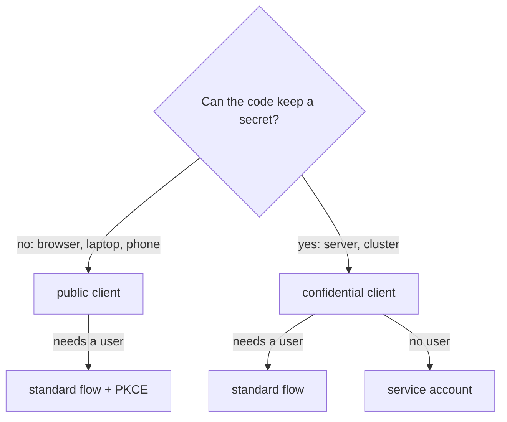

# Public Clients, Confidential Clients And Client Authentication

Before Keycloak issues a token, it wants to know which application is asking. Some applications can prove that with a secret, and some cannot, because their code runs on a machine the user controls. This part shows the two kinds of client that follow from that fact, and how the kind that can keep a secret proves who it is.

## Two kinds of client

OAuth 2.0, the framework Keycloak uses to issue tokens, splits clients by one question: can the client keep a credential secret? A **public client** cannot. A single page application runs in the user's browser, and a command-line tool runs on the user's laptop, so anyone can read the code and any secret in it. A **confidential client** can. A service in a cluster keeps its secret in a Kubernetes Secret, out of reach of users.

The kind decides what Keycloak asks for at the **token endpoint**, the address where a client gets tokens: `/realms/<realm>/protocol/openid-connect/token`. A confidential client must authenticate there. A public client sends only its client ID, so Keycloak trusts it less and lets it use fewer grants:

| | Public client | Confidential client |
| --- | --- | --- |
| Example | Single page application, mobile app, command-line tool | Server-side web application, background service, API gateway |
| Authenticates at the token endpoint | No, it sends only `client_id` | Yes, with a client secret or a signed JWT |
| Client credentials grant (no user) | Not possible | Possible, with a service account |
| Browser sign-in | Yes, with Proof Key for Code Exchange (PKCE) | Yes |
| In the Admin Console | **Client authentication** off | **Client authentication** on |



The diagram shows the choice: the place the code runs decides the client type, and the type decides which grants are left.

## Read the client settings

The playground realm already holds one client of each kind, so look at how Keycloak stores the difference. `kcadm.sh` is Keycloak's administration command-line tool; it calls the Admin REST API. The helper below runs it inside the Keycloak pod and keeps its session file in `/tmp`. Paste it into your terminal, then sign in to the `master` realm as the lab-only administrator:

<!-- astrona:playground:renew -->

```sh
NAMESPACE=clients-demo
kcadm() {
  kubectl -n "$NAMESPACE" exec -i deploy/keycloak -- \
    /opt/keycloak/bin/kcadm.sh "$@" --config /tmp/kcadm.config
}
kcadm config credentials --server http://localhost:8080 --realm master --user admin --password admin
```

Now list the three clients with the fields that decide their type and their grants:

```sh
kcadm get clients -r inventory \
  --fields clientId,publicClient,clientAuthenticatorType,standardFlowEnabled,directAccessGrantsEnabled,serviceAccountsEnabled \
  | jq '.[] | select(.clientId | startswith("inventory-"))'
```

The output is one JSON object per client. `inventory-cli` and `inventory-web` have `publicClient` set to `true`. `inventory-reporter` has `publicClient` set to `false`, `clientAuthenticatorType` set to `client-secret` and `serviceAccountsEnabled` set to `true`. The field `publicClient` is the switch the Admin Console calls **Client authentication**, with the opposite meaning: client authentication on means `publicClient` is `false`.

## How a confidential client authenticates

A confidential client proves who it is with every request to the token endpoint. Keycloak calls the method the **client authenticator**, and the most common one is the **client secret**: a password for the client that Keycloak generates. The client can send it two ways. With `client_secret_basic`, it sends the client ID and the secret in an HTTP `Authorization: Basic` header. With `client_secret_post`, it sends them as form fields in the body. Keycloak accepts both for a client with the `client-secret` authenticator.

Try both with the client credentials grant, in which the client asks for a token for itself. First with the `Authorization` header, which `curl -u` builds for you:

```sh
kubectl -n clients-demo exec deploy/tester -- \
  curl -s -u inventory-reporter:inventory-reporter-secret \
    http://keycloak:8080/realms/inventory/protocol/openid-connect/token \
    -d grant_type=client_credentials | jq 'keys'
```

Then with form fields, and once more with a wrong secret:

```sh
kubectl -n clients-demo exec deploy/tester -- \
  curl -s http://keycloak:8080/realms/inventory/protocol/openid-connect/token \
    -d grant_type=client_credentials -d client_id=inventory-reporter \
    -d client_secret=inventory-reporter-secret | jq 'keys'
kubectl -n clients-demo exec deploy/tester -- \
  curl -s -o /dev/null -w '%{http_code}\n' http://keycloak:8080/realms/inventory/protocol/openid-connect/token \
    -d grant_type=client_credentials -d client_id=inventory-reporter -d client_secret=wrong
```

The first two requests return the same kind of response: JSON with the keys `access_token`, `expires_in` and `token_type`, among others. The third returns the status code `401`: Keycloak refused the client before it looked at anything else. The secret, not the client ID, is what proves who is asking.

A client secret has one weakness: Keycloak and the client share it, so it travels with every request. Keycloak also supports **signed JWT** authentication. With `private_key_jwt` (in the console, "Signed JWT"), the client signs a short JSON Web Token with its own private key and sends it as `client_assertion`; Keycloak checks it with the client's public key, so no secret ever leaves the client. With `client_secret_jwt`, the client signs the JWT with the shared secret instead. This course uses client secrets, but the rule is the same for all of them: a confidential client authenticates, a public client does not.

## A public client cannot use client credentials

The difference is not only in the settings. Send the same client credentials grant as `inventory-cli`, which is public and has no secret to send:

```sh
kubectl -n clients-demo exec deploy/tester -- \
  curl -s http://keycloak:8080/realms/inventory/protocol/openid-connect/token \
    -d grant_type=client_credentials -d client_id=inventory-cli | jq
```

Keycloak answers with an error object instead of tokens. Its `error_description` says that a public client may not get a token for a service account. A token that represents the client itself needs a client that can prove who it is, and a public client cannot.

You now know the two client types and what each one is allowed to do. A confidential client authenticates with a secret or a signed JWT, and only it can use the client credentials grant. A public client authenticates with nothing, so Keycloak protects its sign-ins another way: by sending the authorization code only to addresses the client has registered. Those addresses are the next question.

## Common pitfalls

> [!WARNING]
> - **Making a single page application confidential.** Its secret ends up in JavaScript that every user can read. A browser client is always public.
> - **Reading the console switch backwards.** **Client authentication** on means a confidential client (`publicClient: false`).
> - **Putting a client secret in a command-line tool.** Anyone with the tool has the secret. Use a public client.
> - **Treating `401` as a missing user.** At the token endpoint, a `401` means the client failed to authenticate, before any user is checked.
