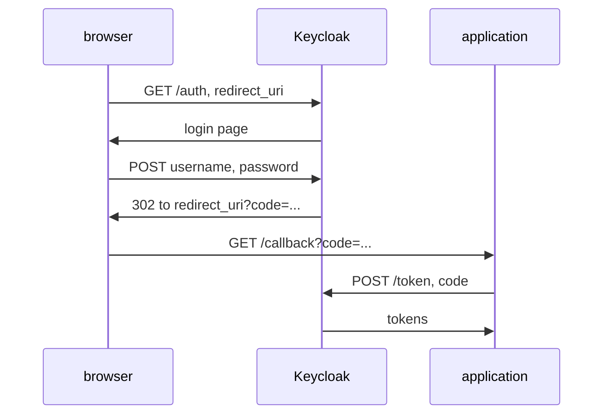

# Valid Redirect URIs And The Front Channel

A public client has no secret, so in a browser sign-in the only thing that ties the result to the right application is the address the browser goes back to. If Keycloak sends the user's authorization code to the wrong address, whoever owns that address can sign in as the user. This part shows where the code travels and how Keycloak decides whether an address is allowed.

## The front channel and the back channel

In a browser sign-in, the **authorization code flow**, messages take two different paths. The **front channel** is every message that passes through the user's browser as a redirect: the application sends the browser to Keycloak, and Keycloak sends the browser back. The **back channel** is a direct request from the application to Keycloak, with no browser in between: the request that turns the code into tokens.



The diagram shows the authorization code travelling in the front channel, through the browser to the `redirect_uri`, and the tokens travelling in the back channel.

The **redirect URI** is the address in the request parameter `redirect_uri`. Keycloak sends the browser there with the code. The browser follows the redirect to any address at all, so the only check is the one Keycloak makes before it redirects: the address must be one of the client's **valid redirect URIs**.

## How Keycloak matches a redirect URI

Keycloak compares the `redirect_uri` of a request with the client's list of valid redirect URIs. An entry without a wildcard must match exactly. An entry may end with `*`, which matches anything from that point on, so `http://localhost:5173/*` matches every path on that origin. An entry that is only `*` matches every address on every website.

Look at the list for `inventory-web`. The helper `kcadm` from the module's first part must be defined in your terminal; define it again if this is a new terminal:

<!-- astrona:playground:renew -->

```sh
NAMESPACE=clients-demo
kcadm() {
  kubectl -n "$NAMESPACE" exec -i deploy/keycloak -- \
    /opt/keycloak/bin/kcadm.sh "$@" --config /tmp/kcadm.config
}
kcadm config credentials --server http://localhost:8080 --realm master --user admin --password admin
kcadm get clients -r inventory -q clientId=inventory-web --fields clientId,redirectUris,webOrigins
```

The client lists exactly one valid redirect URI, `http://localhost:5173/callback`, and one web origin, `+`.

Now send the first request of the flow, the authorization request, from the `tester` pod. A helper builds the URL for any redirect URI and prints the HTTP status code of Keycloak's answer, followed by `login form` when the answer is the login page:

```sh
start_sign_in() {
  kubectl -n clients-demo exec deploy/tester -- sh -c '
    URL="http://keycloak:8080/realms/inventory/protocol/openid-connect/auth?client_id=inventory-web&response_type=code&scope=openid&redirect_uri=$(printf %s "$1" | jq -sRr @uri)"
    curl -s -w "\n%{http_code}\n" "$URL" | grep -o -e "login-actions/authenticate" -e "^[0-9][0-9][0-9]$" | sort -u' sh "$1"
}
start_sign_in http://localhost:5173/callback
start_sign_in http://attacker.example/callback
```

For `http://localhost:5173/callback`, Keycloak answers `200` with the login page: the helper prints `200` and `login-actions/authenticate`, the address the login form posts to. For `http://attacker.example/callback`, Keycloak answers `400` with an error page that says the `redirect_uri` parameter is invalid, and there is no login form. Keycloak refused before the user typed anything.

## What a wildcard gives away

To see why a wildcard is dangerous, open the client up for a moment. This changes the valid redirect URIs to `*`, sends the same two requests, and then puts the exact address back:

```sh
WEB_ID=$(kcadm get clients -r inventory -q clientId=inventory-web --fields id --format csv --noquotes | tr -d '\r')
kcadm update "clients/$WEB_ID" -r inventory -s 'redirectUris=["*"]'
start_sign_in http://attacker.example/callback
kcadm update "clients/$WEB_ID" -r inventory -s 'redirectUris=["http://localhost:5173/callback"]'
start_sign_in http://attacker.example/callback
```

With `*`, the request for `http://attacker.example/callback` gets the login page. A user who signs in there sends their authorization code to `attacker.example`. Because `inventory-web` is a public client, the code alone is enough to get tokens unless the client also requires Proof Key for Code Exchange (PKCE), a check that ties the code to the application that started the flow. With the exact address back, Keycloak refuses the request again.

A wildcard at the end of a path is less dangerous, but it still lets any page on that origin receive codes, including pages you did not write for it. The safe rule is short: list the exact callback addresses the application uses, one entry for each.

You now know that the authorization code travels through the browser, that Keycloak sends it only to a valid redirect URI, and that a wildcard extends that trust to every address it matches. The redirect controls where the code goes. It does not control which websites may read Keycloak's answers from JavaScript, and that is a separate setting.

## Common pitfalls

> [!WARNING]
> - **Using `*` "for now" during development.** It lets any website receive authorization codes. Add each development address as its own entry instead.
> - **Expecting the browser to refuse a bad redirect.** The browser follows any redirect. Keycloak's check is the only one.
> - **Adding the address with a different port or scheme.** `http://localhost:5173/callback` and `http://localhost:5174/callback` are different addresses, and so are `http` and `https`.
> - **Testing only the address that should work.** Also send one that must fail, and check that Keycloak refuses it.
