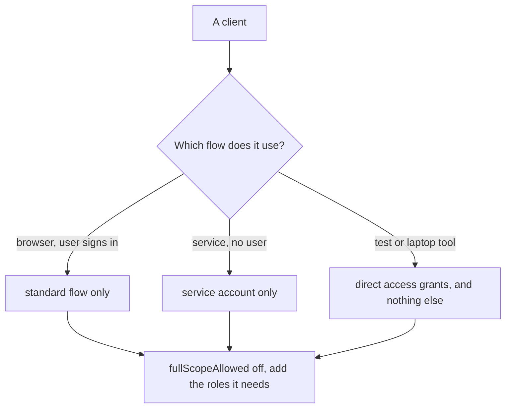

# Client Settings And Capabilities

A client does more than hold a secret and a redirect address. Each client also carries a set of switches that say which ways of getting a token it may use, how much of a user's access its tokens carry, and whether the user is asked first. Every switch left on is a door left open. This part shows the switches that matter most, and how to prove that a door is closed.

## The capabilities of a client

Keycloak calls the ways of getting a token **flows** or **grants**, and each one is a switch on the client. In the Admin Console they sit under **Capability config**. With `kcadm.sh` they are plain fields:

| Console label | Field | What it allows | Leave it on for |
| --- | --- | --- | --- |
| Standard flow | `standardFlowEnabled` | The authorization code flow, a browser sign-in that ends with a code | Every application with a signed-in user in a browser |
| Implicit flow | `implicitFlowEnabled` | Tokens delivered in the redirect address itself, with no code exchange | Nothing new. It is a legacy flow |
| Direct access grants | `directAccessGrantsEnabled` | The password grant: the client sends the user's username and password | Tests and command-line tools only |
| Service accounts roles | `serviceAccountsEnabled` | The client credentials grant, a token for the client itself | A confidential client that acts without a user |

The rule is short: **switch on only the flows the application really uses.** A browser application needs the standard flow and nothing else. A background service needs service accounts and nothing else.

Read the switches for the three playground clients. The helper is the one from the first part; define it again if your terminal is new:

```sh
NAMESPACE=clients-demo
kcadm() {
  kubectl -n "$NAMESPACE" exec -i deploy/keycloak -- \
    /opt/keycloak/bin/kcadm.sh "$@" --config /tmp/kcadm.config
}
kcadm config credentials --server http://localhost:8080 --realm master --user admin --password admin
kcadm get clients -r inventory \
  --fields clientId,standardFlowEnabled,implicitFlowEnabled,directAccessGrantsEnabled,serviceAccountsEnabled,fullScopeAllowed,consentRequired \
  | jq '.[] | select(.clientId | startswith("inventory-"))'
```

`inventory-web` has only `standardFlowEnabled` on. `inventory-cli` has only `directAccessGrantsEnabled` on. `inventory-reporter` has only `serviceAccountsEnabled` on. Each client does one job.

## Prove that a grant is closed

A switch that is off must make the request fail, and the way to know is to send the request. Ask for a token with the password grant, first from the command-line tool, then from the browser client:

```sh
for CLIENT in inventory-cli inventory-web; do
  echo "== $CLIENT"
  kubectl -n clients-demo exec deploy/tester -- \
    curl -s http://keycloak:8080/realms/inventory/protocol/openid-connect/token \
      -d grant_type=password -d "client_id=$CLIENT" \
      -d username=alice -d password=alice-password | jq -c '{error, has_token: has("access_token")}'
done
```

`inventory-cli` gets a token. `inventory-web` gets the error `unauthorized_client`: the client is not allowed to use that grant, and Keycloak does not look at the password. This matters for a browser client. If its code could send the password grant, any script on the page that sees the password could also swap it for tokens, and the sign-in page would no longer be the only place that takes a password.

## The implicit flow

The **implicit flow** asks for `response_type=token`. Keycloak puts the access token in the redirect address, in the fragment after `#`, with no code and no token request. The browser history, the address bar and any script on the page can read it, and PKCE cannot protect it, because there is no code to protect. Current guidance for OAuth 2.0 has dropped it, and the authorization code flow with PKCE replaces it.

Check that the flow is closed for `inventory-web` by asking for a token directly. The count is the number of login forms Keycloak sends back:

```sh
kubectl -n clients-demo exec deploy/tester -- sh -c '
  curl -s "http://keycloak:8080/realms/inventory/protocol/openid-connect/auth?client_id=inventory-web&response_type=token&scope=openid&redirect_uri=http%3A%2F%2Flocalhost%3A5173%2Fcallback" \
  | grep -c login-actions/authenticate || true'
```

The count is `0`. Keycloak refuses the request before it shows a login page. Turn the flow on, ask again, and then turn it off:

```sh
WEB_ID=$(kcadm get clients -r inventory -q clientId=inventory-web --fields id --format csv --noquotes | tr -d '\r')
kcadm update "clients/$WEB_ID" -r inventory -s implicitFlowEnabled=true
```

Repeat the `curl` command. The count is now `1`: the login page appears, and after a sign-in the token would travel in the address. Close the door again:

```sh
kcadm update "clients/$WEB_ID" -r inventory -s implicitFlowEnabled=false
```

## How much access a token carries

A user has roles, and a token can carry them. Keycloak decides which roles reach a client's tokens with two things: the user's roles, and the client's **scope**. The switch **Full scope allowed** (`fullScopeAllowed`) is on by default. On means that the token carries every role the user has, whatever the client needs. Off means that the token carries only the roles that the client's scope mappings list.

See it with a role that only an administrator would have. Create the role, give it to `alice`, and read the roles in a token for `inventory-cli`:

```sh
kcadm create roles -r inventory -s name=inventory-admin
kcadm add-roles -r inventory --uusername alice --rolename inventory-admin

token_roles() {
  kubectl -n clients-demo exec deploy/tester -- \
    curl -s http://keycloak:8080/realms/inventory/protocol/openid-connect/token \
      -d grant_type=password -d client_id=inventory-cli \
      -d username=alice -d password=alice-password | jq -r .access_token \
    | jq -R 'split(".")[1] | gsub("-";"+") | gsub("_";"/") | @base64d | fromjson | .realm_access.roles // []'
}
token_roles
```

The list contains `inventory-admin`, even though a command-line tool for reading stock has no use for it. If a token like that is stolen, or sent to a service that trusts roles, the tool carries the user's administrator rights wherever it goes. Turn the full scope off for the client and read the roles again:

```sh
CLI_ID=$(kcadm get clients -r inventory -q clientId=inventory-cli --fields id --format csv --noquotes | tr -d '\r')
kcadm update "clients/$CLI_ID" -r inventory -s fullScopeAllowed=false
token_roles
```

The role is gone. The token now carries no role that the client was not given on purpose. To give the client a role again, add it as a scope mapping of the client, in **Client scopes**, **Scope** in the Admin Console. Turn the full scope back on, so that the playground stays as the next parts expect:

```sh
kcadm update "clients/$CLI_ID" -r inventory -s fullScopeAllowed=true
```

## Consent

The switch **Consent required** (`consentRequired`) makes Keycloak ask the user to approve what the client may read, once, before the first sign-in. It is off by default for the clients you create, and it makes sense for a client from another organization, which the user has no reason to trust. For an application that your own team runs, consent only adds a screen, so leave it off.



The diagram sums up the part: choose the one flow the client uses, then trim the roles it carries.

## Common pitfalls

> [!WARNING]
> - **Leaving direct access grants on for a browser client.** It is easy to forget, because the sign-in works either way. The browser client then accepts a password sent from a script.
> - **Leaving the implicit flow on "in case it is needed".** Nothing current needs it, and tokens in the address are the kind of leak it was removed for.
> - **Reading a closed grant as a wrong password.** `unauthorized_client` is an answer about the client. A wrong password is `invalid_grant`.
> - **Turning off full scope and forgetting the scope mappings.** The client then gets tokens with none of the roles it needs, and a service answers `403`. Add the roles it needs as scope mappings.

## Your mission: Trim A Browser Client To The One Flow It Uses

You can now list the switches of a client and prove that a grant is closed with a request that must fail. The graded lab gives you a realm where the browser client `inventory-web` can use every flow and carries every role of the user, and asks you to trim it to the one flow it uses while the sign-in keeps working.

The lab runs in its own cluster, so first pause your playground. Nothing in it is lost:

```sh
astrona stop ats-090-playground-010-01
```

Then start the lab:

```sh
astrona run --git ssh://git@github.com/astrona-io/ATS090.git -c sections/section-010/module-01/labs/lab-02
```

The task is on the next page. Solve it on your own first. When you think you are done, send it for grading:

```sh
astrona submit -c sections/section-010/module-01/labs/lab-02
```

When the lab is done, remove it and start your playground again:

```sh
astrona destroy ats-090-lab-010-02
astrona start ats-090-playground-010-01
```
