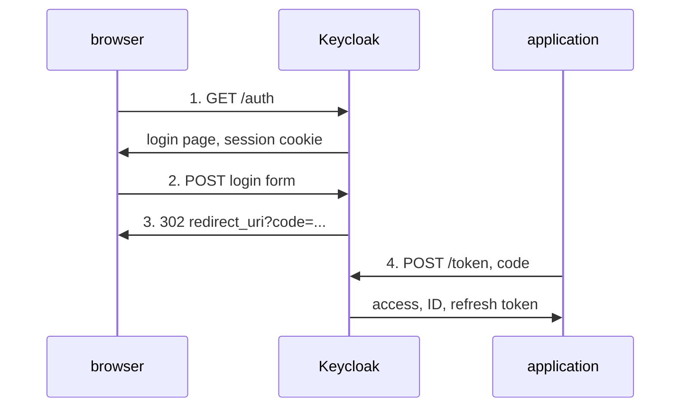

# The Authorization Code Flow Step By Step

A library hides the authorization code flow behind one function call, so when a sign-in fails, the error rarely says which step broke. The fastest way to understand the flow is to send each request yourself and read each answer. This part does that from a shell in the `tester` pod, with nothing but `curl`.

## The steps

The flow has four requests. The first three pass through the browser, the **front channel**; the last one goes straight from the application to Keycloak, the **back channel**.



The diagram shows the authorization request, the login, the redirect with the code, and the code exchange at the token endpoint.

Each step has one job. The **authorization request** (step 1) tells Keycloak which client is asking, which redirect URI to use and what to return (`response_type=code`). The **login** (step 2) checks the user. The **redirect** (step 3) hands the code to the application through the browser. The **token request** (step 4) turns the code into tokens. You will run them in that order.

## Step 1: the authorization request

Open a shell in the `tester` pod. Every command in the rest of this part runs inside that shell, so variables and files carry over from one step to the next:

<!-- astrona:playground:renew -->

```sh
kubectl -n pkce-demo exec -it deploy/tester -- sh
```

Set the addresses, then send the authorization request. A browser would follow this URL; `curl` saves the page and the session cookie Keycloak sets, because the login in the next step needs that cookie:

```sh
OIDC=http://keycloak:8080/realms/inventory/protocol/openid-connect
REDIRECT_URI=http://localhost:5173/callback
rm -f /tmp/cookies
curl -s -c /tmp/cookies -b /tmp/cookies -o /tmp/login.html \
  "$OIDC/auth?client_id=inventory-web&response_type=code&scope=openid&state=state-1234&redirect_uri=$(printf %s "$REDIRECT_URI" | jq -sRr @uri)"
FORM_ACTION=$(grep -o 'action="[^"]*login-actions/authenticate[^"]*"' /tmp/login.html | head -n 1 \
  | sed -e 's/^action="//' -e 's/"$//' -e 's/&amp;/\&/g')
echo "$FORM_ACTION"
```

Keycloak answered with its login page, and the last command prints the address the login form posts to: a URL under `/realms/inventory/login-actions/authenticate` with a `session_code`, an `execution`, the `client_id` and a `tab_id`. Keycloak keeps the state of this sign-in on its side and finds it again through those values and the cookie. The `scope=openid` parameter makes this an OpenID Connect sign-in, so Keycloak will also return an ID token.

## Step 2 and 3: the login and the redirect

A browser would show the page and post the form when the user clicks **Sign In**. Post `alice`'s credentials to the form's address, and save the response headers instead of following the redirect:

```sh
curl -s -c /tmp/cookies -b /tmp/cookies -o /dev/null -D /tmp/headers \
  --data-urlencode username=alice --data-urlencode password=alice-password \
  "$FORM_ACTION"
grep -i '^location:' /tmp/headers
```

Keycloak answers with a `302` redirect. The `Location` header is the redirect URI with parameters added. Two of them matter here: `state=state-1234`, the value you sent in step 1, and `code`, the authorization code. You will also see `iss`, the realm's address, which lets the application check which identity provider answered. A browser would now load `http://localhost:5173/callback?...`, and the application's JavaScript would read the code from the address.

Keep the code in a variable:

```sh
CODE=$(grep -i '^location:' /tmp/headers | sed -n 's/.*[?&]code=\([^&]*\).*/\1/p' | tr -d '\r')
echo "$CODE"
```

## Step 4: the code exchange

The application now posts the code to the token endpoint. It sends the same `redirect_uri` as in step 1, because Keycloak checks that the code is used by the flow that asked for it. `inventory-web` is a public client, so it sends only its client ID and no secret:

```sh
curl -s "$OIDC/token" -d grant_type=authorization_code -d client_id=inventory-web \
  --data-urlencode code="$CODE" --data-urlencode redirect_uri="$REDIRECT_URI" | jq 'keys'
```

The response holds `access_token`, `id_token`, `refresh_token`, `expires_in`, `token_type` and a few more keys. The sign-in is complete.

Now send the same request a second time:

```sh
curl -s "$OIDC/token" -d grant_type=authorization_code -d client_id=inventory-web \
  --data-urlencode code="$CODE" --data-urlencode redirect_uri="$REDIRECT_URI" | jq
```

This time Keycloak answers with an error object whose `error` is `invalid_grant`. An authorization code works once. It also expires quickly, after about a minute with Keycloak's default settings, so if your first exchange failed with the same error, run the steps again faster.

You have now run the whole flow and seen where each value goes. The code travels through the browser, which is the weak point: anything that can read the redirect address, such as browser history, a log or a malicious browser extension, can read the code. For a public client, Keycloak has no secret to check in step 4, so anyone with the code and the client ID could have sent that request. Closing that gap is what PKCE is for.

Leave the `tester` shell with `exit` when you are done.

## Common pitfalls

> [!WARNING]
> - **Following the redirect with `curl -L`.** `curl` then tries to load `http://localhost:5173/callback`, and the code is lost in the error. Read the `Location` header instead.
> - **Sending a different `redirect_uri` in step 4.** Keycloak refuses the exchange; it must be the exact value from step 1.
> - **Reusing a code.** Each code works once, for about a minute. Start a new flow.
> - **Losing the cookie between steps 1 and 2.** Without the session cookie, Keycloak cannot find the sign-in and shows an error page instead of redirecting.
