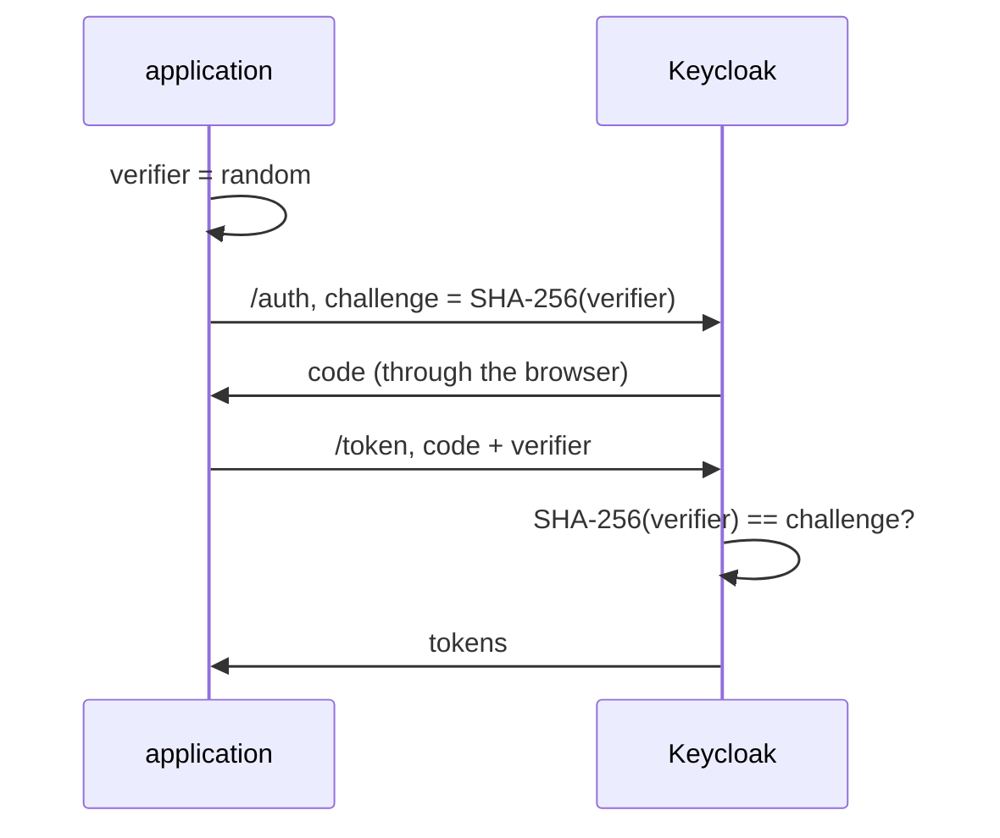

# Proof Key For Code Exchange (PKCE)

In the authorization code flow, a public client sends only its client ID when it exchanges the code for tokens. So anyone who reads the code on its way through the browser can exchange it too. Proof Key for Code Exchange (PKCE), defined in RFC 7636, closes that gap without a client secret. This part shows how it works, runs a flow with it, and makes Keycloak require it.

## How PKCE ties the code to the application

Before the flow starts, the application creates a random string, the **code verifier**, and keeps it in memory. It sends a hash of it, the **code challenge**, with the authorization request, and names the hash method in `code_challenge_method`. Keycloak stores the challenge with the code. When the application exchanges the code, it sends the verifier itself, and Keycloak hashes it and compares the result with the stored challenge.



The diagram shows the verifier staying inside the application and only its hash travelling with the authorization request.

The challenge passes through the browser, but it is a hash: nobody can compute the verifier from it. The verifier only travels in the back channel, in the token request. Someone who steals the code does not have the verifier, so their token request fails.

There are two methods. With **`S256`**, the challenge is the SHA-256 hash of the verifier, encoded as Base64URL without padding. With **`plain`**, the challenge is the verifier itself, so anyone who reads the authorization request also reads the verifier. `plain` exists only for clients that cannot compute SHA-256, and every current platform can. Use `S256`.

## Run a flow with PKCE

Open a shell in the `tester` pod again; the commands below run inside it:

<!-- astrona:playground:renew -->

```sh
kubectl -n pkce-demo exec -it deploy/tester -- sh
```

Create a verifier and its `S256` challenge. The verifier is 43 to 128 characters of letters, digits and `-._~`; random bytes in Base64 without `=`, `+` and `/` meet that rule:

```sh
CODE_VERIFIER=$(head -c 48 /dev/urandom | base64 | tr -d '\n=+/')
CODE_CHALLENGE=$(printf '%s' "$CODE_VERIFIER" | openssl dgst -sha256 -binary | base64 | tr '+/' '-_' | tr -d '=\n')
echo "$CODE_VERIFIER"
echo "$CODE_CHALLENGE"
```

Now run the first three steps of the flow with the challenge in the authorization request. These are the same commands as for a flow without PKCE, with two parameters added:

```sh
OIDC=http://keycloak:8080/realms/inventory/protocol/openid-connect
REDIRECT_URI=http://localhost:5173/callback
rm -f /tmp/cookies
curl -s -c /tmp/cookies -b /tmp/cookies -o /tmp/login.html \
  "$OIDC/auth?client_id=inventory-web&response_type=code&scope=openid&state=state-1234&redirect_uri=$(printf %s "$REDIRECT_URI" | jq -sRr @uri)&code_challenge=$CODE_CHALLENGE&code_challenge_method=S256"
FORM_ACTION=$(grep -o 'action="[^"]*login-actions/authenticate[^"]*"' /tmp/login.html | head -n 1 \
  | sed -e 's/^action="//' -e 's/"$//' -e 's/&amp;/\&/g')
curl -s -c /tmp/cookies -b /tmp/cookies -o /dev/null -D /tmp/headers \
  --data-urlencode username=alice --data-urlencode password=alice-password "$FORM_ACTION"
CODE=$(grep -i '^location:' /tmp/headers | sed -n 's/.*[?&]code=\([^&]*\).*/\1/p' | tr -d '\r')
```

First try the exchange the way an attacker with only the code would, without the verifier:

```sh
curl -s "$OIDC/token" -d grant_type=authorization_code -d client_id=inventory-web \
  --data-urlencode code="$CODE" --data-urlencode redirect_uri="$REDIRECT_URI" | jq
```

Keycloak answers with the error `invalid_grant`, and the description says the PKCE verification failed because the code verifier is missing. The code was issued with a challenge, so it is worthless without the verifier. Keycloak also uses up a code on a failed exchange, so run the three steps again for a new code before the next command. Then exchange it with the verifier:

```sh
curl -s "$OIDC/token" -d grant_type=authorization_code -d client_id=inventory-web \
  --data-urlencode code="$CODE" --data-urlencode redirect_uri="$REDIRECT_URI" \
  --data-urlencode code_verifier="$CODE_VERIFIER" | jq 'keys'
```

The response holds the tokens. Leave the shell with `exit`.

## Make Keycloak require PKCE

So far PKCE was the application's choice: a flow without a challenge still works for `inventory-web`. An attacker who starts their own flow simply leaves the challenge out. To close that path, Keycloak must refuse any authorization request without PKCE. The client attribute `pkce.code.challenge.method` does that; in the Admin Console it is **Proof Key for Code Exchange Code Challenge Method** under the client's **Advanced** tab.

Back in your own terminal, set it to `S256` with `kcadm.sh`, Keycloak's administration command-line tool, run inside the Keycloak pod:

```sh
NAMESPACE=pkce-demo
kcadm() {
  kubectl -n "$NAMESPACE" exec -i deploy/keycloak -- \
    /opt/keycloak/bin/kcadm.sh "$@" --config /tmp/kcadm.config
}
kcadm config credentials --server http://localhost:8080 --realm master --user admin --password admin
WEB_ID=$(kcadm get clients -r inventory -q clientId=inventory-web --fields id --format csv --noquotes | tr -d '\r')
kcadm update "clients/$WEB_ID" -r inventory -s 'attributes."pkce.code.challenge.method"=S256'
```

Then send an authorization request without a challenge, and print only the redirect Keycloak answers with:

```sh
kubectl -n pkce-demo exec deploy/tester -- sh -c '
  curl -s -o /dev/null -D - "http://keycloak:8080/realms/inventory/protocol/openid-connect/auth?client_id=inventory-web&response_type=code&scope=openid&redirect_uri=http%3A%2F%2Flocalhost%3A5173%2Fcallback" \
  | grep -i "^location:"'
```

Keycloak no longer shows the login page. It redirects straight back to the callback with `error=invalid_request` and an `error_description` that says the `code_challenge_method` parameter is missing. The same happens for `code_challenge_method=plain`: with the attribute set to `S256`, only `S256` is accepted.

You now know how PKCE ties a code to the application that started the flow, how to run a flow with it, and how to make Keycloak require it. A public browser client should always have this attribute set. The code is now protected, but the application still trusts two things it cannot check yet: that the redirect it receives answers its own request, and that the ID token was issued for this sign-in.

## Common pitfalls

> [!WARNING]
> - **Relying on the application to send PKCE.** Without the client attribute, an attacker's flow simply leaves it out. Set `pkce.code.challenge.method` on the client.
> - **Setting the method to `plain`.** The challenge then is the verifier, and anyone who sees the authorization request can use the code.
> - **Encoding the challenge with standard Base64.** It must be Base64URL (`-` and `_`) with no `=` padding, or Keycloak's comparison fails.
> - **Creating a new verifier for the exchange.** The verifier must be the one whose hash went into the authorization request.

## Your mission: Require PKCE With S256 For A Public Client

You can now run a flow with PKCE and make Keycloak require it. The graded lab gives you a realm where `inventory-web` requires PKCE with the weak `plain` method, and asks you to require `S256` and prove what Keycloak accepts and refuses.

The lab runs in its own cluster, so first pause your playground. Nothing in it is lost:

```sh
astrona stop ats-090-playground-020-01
```

Then start the lab:

```sh
astrona run --git ssh://git@github.com/astrona-io/ATS090.git -c sections/section-020/module-01/labs/lab-01
```

The task is on the next page. Solve it on your own first. When you think you are done, send it for grading:

```sh
astrona submit -c sections/section-020/module-01/labs/lab-01
```

When the lab is done, remove it and start your playground again:

```sh
astrona destroy ats-090-lab-020-01
astrona start ats-090-playground-020-01
```
