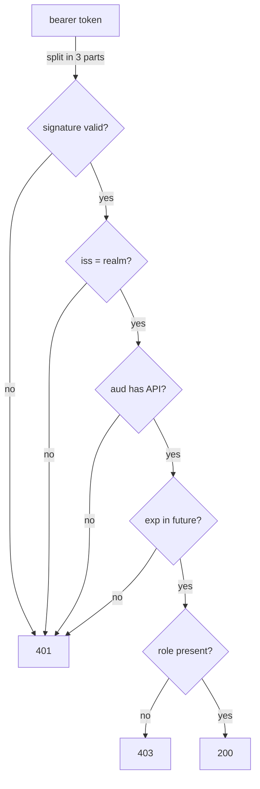

# What An API Checks In An Access Token

An API that receives a request with a bearer token has to decide, alone and quickly, whether to trust it. It does not call Keycloak for every request. It runs a fixed list of checks on the token, and the first check that fails decides the answer. This part walks through that list with a real token and a real API, and shows where to read the reason for a refusal.

## Get a token and call the API

Three small helpers save typing. `get_alice_token` asks Keycloak for an access token for `alice` with the password grant of `inventory-cli`; a real application would use the authorization code flow, and OAuth 2.1 drops the password grant. `call_api` sends `GET /items` with a token and prints the status code and the body. `decode_jwt` prints the payload of a token as JSON. Paste them into your terminal:

<!-- astrona:playground:renew -->

```sh
get_alice_token() {
  kubectl -n tokens-demo exec deploy/tester -- sh -c '
    curl -s http://keycloak:8080/realms/inventory/protocol/openid-connect/token \
      -d grant_type=password -d client_id=inventory-cli \
      -d username=alice -d password=alice-password -d scope=openid \
    | jq -r .access_token'
}
call_api() {
  kubectl -n tokens-demo exec deploy/tester -- \
    curl -s -w '\nHTTP %{http_code}\n' -H "Authorization: Bearer $1" http://inventory-api:8080/items
}
decode_jwt() {
  jq -R 'split(".")[1] | gsub("-";"+") | gsub("_";"/") | @base64d | fromjson'
}
```

Get a token and send it to the API:

```sh
TOKEN=$(get_alice_token)
call_api "$TOKEN"
```

The API answers `HTTP 401` with a JSON body. Its `error` is `invalid_token`, and its `reason` says that the token's `aud` does not include `inventory-api`. The API also writes the reason to its log, one line per request:

```sh
kubectl -n tokens-demo logs deploy/inventory-api --tail=3
```

The last line is the same refusal, with the status and the reason. When an API refuses a token, its log is the first place to look; most APIs write the reason there and give the client only the status.

## The checks, in order

`inventory-api` runs the checks below, in this order. A real API, or the library it uses, does the same work:



The diagram shows each check as a gate: every failure before the role check gives `401`, and a missing role gives `403`.

Each check protects against something different:

| Check | Claim | What it protects against |
| --- | --- | --- |
| Signature | header `kid`, `alg` | A token someone made or changed: only Keycloak has the private key |
| Issuer | `iss` | A token from another realm or another identity provider |
| Audience | `aud` | A token issued for a different API, replayed against this one |
| Expiry | `exp` | A stolen token used later |
| Type | `typ` | An ID token sent as if it were an access token |
| Role | `realm_access.roles` | A user who is signed in but not allowed to use this API |

The first five checks decide whether the token is acceptable at all, so a failure is `401 Unauthorized`. The role check decides whether the user may do this, so a failure is `403 Forbidden`. The difference tells the client what to do next: get another token, or stop trying.

## Compare the token with the checks

Now look at the token the way the API does. Decode it and print the claims the checks use:

```sh
printf '%s' "$TOKEN" | decode_jwt | jq '{iss, aud, azp, typ, exp, realm_access}'
```

`iss` is `http://keycloak:8080/realms/inventory`, the realm the API expects. `typ` is `Bearer`, so it is an access token. `realm_access.roles` contains `inventory-reader`. `exp` is a Unix time a few minutes in the future. Only `aud` is wrong: it names `account`, a built-in client whose roles every user of the realm has by default, and not `inventory-api`. The API is right to refuse the token, and the fix belongs in Keycloak's settings for the client that requested it.

Also notice `azp`, the client the token was issued to: `inventory-cli`. `azp` says who asked; `aud` says for whom. An API checks `aud`, because many clients may call it, and every one of them must request a token meant for it.

You now know the checks an API runs, which status each failure gives, and where the API writes the reason. The signature check is the one that makes the rest meaningful, and it raises a question of its own: how does the API know Keycloak's public key, and what happens when Keycloak changes it?

## Common pitfalls

> [!WARNING]
> - **Decoding instead of validating.** Anyone can decode a JWT and read its claims. Only the signature check proves Keycloak issued it.
> - **Checking the signature and nothing else.** Every token of the realm has a valid signature, including tokens meant for other APIs.
> - **Confusing `azp` and `aud`.** `azp` is the client that asked; `aud` is who the token is for.
> - **Answering `403` for a bad token.** A token that fails the signature, issuer, audience or expiry check gets `401`.
