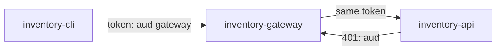

# Forwarding The Token Through A Gateway

The simplest way to pass a user to the next service is to pass the user's token along. Many gateways do exactly that by default. This part sends `alice`'s token through `inventory-gateway`, shows where it fails, and shows why the quick fix makes the system less safe than the failure did.

## Send a request through the gateway

The helpers below get an access token for `alice` from `inventory-cli` with the password grant (lab-only; OAuth 2.1 drops this grant), call a service with a token, and decode a token's payload. Paste them into your terminal:

<!-- astrona:playground:renew -->

```sh
get_alice_token() {
  kubectl -n exchange-demo exec deploy/tester -- sh -c '
    curl -s http://keycloak:8080/realms/inventory/protocol/openid-connect/token \
      -d grant_type=password -d client_id=inventory-cli \
      -d username=alice -d password=alice-password -d scope=openid \
    | jq -r .access_token'
}
call_service() {
  kubectl -n exchange-demo exec deploy/tester -- \
    curl -s -w '\nHTTP %{http_code}\n' -H "Authorization: Bearer $2" "http://$1:8080/items"
}
decode_jwt() {
  jq -R 'split(".")[1] | gsub("-";"+") | gsub("_";"/") | @base64d | fromjson'
}
```

Get a token, look at its audience, and send it to the gateway:

```sh
TOKEN=$(get_alice_token)
printf '%s' "$TOKEN" | decode_jwt | jq '{azp, aud, preferred_username}'
call_service inventory-gateway "$TOKEN"
kubectl -n exchange-demo logs deploy/inventory-api --tail=1
```

The token's `azp` is `inventory-cli`, and its `aud` contains `inventory-gateway`: it is meant for the gateway. The gateway, nginx, does not check tokens at all; it forwards the request, `Authorization` header included, to `inventory-api`. The API answers `HTTP 401`, and its log says the audience does not include `inventory-api`.



The diagram shows one token travelling two hops, and the second service refusing it because it was meant for the first.

## The quick fix, and why it is wrong

The fastest way to make the request work is to add `inventory-api` to the audience of `inventory-cli`'s tokens as well. The token then names both services, and both accept it. Look at what that would mean.

The client would hold a token that `inventory-api` accepts directly. Nothing would make a request pass through the gateway any more: the client, or anyone who copies the token from the client, could call the API without the gateway's checks, rate limits and logging. And every service on the path would receive a token that works on every other service on the path. A bug that leaks tokens in one service would leak access to all of them.

The same token also tells the API nothing about the hop it came from: `azp` still says `inventory-cli`. The API cannot tell a request through the gateway from a direct one.

## What the gateway needs instead

The gateway should hand the API a different token: for the same user, so the API can still check her roles, but meant for the API only, and issued to the gateway, so the API can see who called it. That is a new token from Keycloak, requested by the gateway, based on the token the gateway received. OAuth calls that **token exchange**, and Keycloak 26 supports it as **standard token exchange**.

You now know why forwarding a token unchanged fails at the next service, and why the audience must not simply be widened to make it work. The gateway needs a new token for each hop, and Keycloak has to be told that the gateway may ask for one.

## Common pitfalls

> [!WARNING]
> - **Adding every downstream API to the client's audience.** The token then works everywhere, and the gateway can be bypassed.
> - **Turning off the audience check in the API.** Every token of the realm then works on the API.
> - **Assuming the gateway checks tokens.** A plain reverse proxy forwards the header without reading it; the API is the first service that checks.
> - **Reading `azp` as the last hop.** In a forwarded token, `azp` is the client that asked first, not the service that called.
