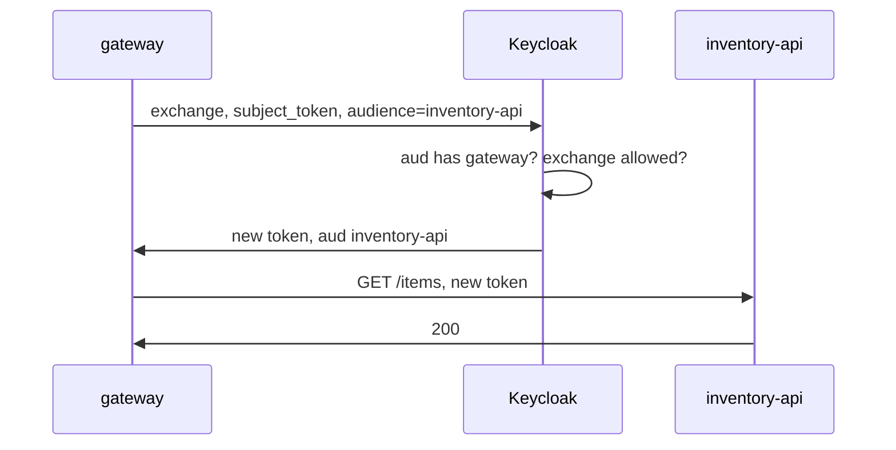

# Standard Token Exchange

The gateway holds `alice`'s token, meant for the gateway, and needs a token meant for `inventory-api`, for the same user. Standard token exchange gives it one in a single request to Keycloak. This part sets up the two things Keycloak requires before it agrees, sends the exchange, and calls the API with the result.

## The exchange request

A token exchange is a request to the realm's token endpoint with the grant type `urn:ietf:params:oauth:grant-type:token-exchange`. The requester sends:

| Parameter | Value |
| --- | --- |
| `client_id`, `client_secret` | The requester's own credentials: only a confidential client may exchange |
| `subject_token` | The token it received, here `alice`'s access token |
| `subject_token_type` | `urn:ietf:params:oauth:token-type:access_token` |
| `audience` | Optional: the client the new token is for, here `inventory-api` |

Keycloak then applies two audience rules. First, the subject token's `aud` must contain the requesting client: a service can only exchange a token that was meant for it. Second, the `audience` parameter only filters: the new token can only contain audiences that are already available to the requester, through its own audience mappers, client scopes or role scope mappings. Keycloak never adds an audience just because the request asks for it.



The diagram shows the gateway trading the token it received for one meant for the API, and calling the API with the new token.

## Try the exchange before setting it up

The first rule already holds in the playground: `inventory-cli`'s tokens carry `inventory-gateway` in `aud`. Send the exchange as the gateway and see what Keycloak says. The helper below sends it from the `tester` pod and prints the response followed by the HTTP status:

<!-- astrona:playground:renew -->

```sh
get_alice_token() {
  kubectl -n exchange-demo exec deploy/tester -- sh -c '
    curl -s http://keycloak:8080/realms/inventory/protocol/openid-connect/token \
      -d grant_type=password -d client_id=inventory-cli \
      -d username=alice -d password=alice-password -d scope=openid \
    | jq -r .access_token'
}
exchange_token() {
  kubectl -n exchange-demo exec deploy/tester -- sh -c '
    curl -s -w "\nHTTP %{http_code}\n" \
      http://keycloak:8080/realms/inventory/protocol/openid-connect/token \
      -d grant_type=urn:ietf:params:oauth:grant-type:token-exchange \
      -d client_id=inventory-gateway -d client_secret=inventory-gateway-secret \
      --data-urlencode subject_token="$1" \
      -d subject_token_type=urn:ietf:params:oauth:token-type:access_token \
      -d audience="$2"' sh "$1" "$2"
}
TOKEN=$(get_alice_token)
exchange_token "$TOKEN" inventory-api
```

Keycloak refuses with an error object and a `4xx` status. Standard token exchange is on in Keycloak 26 as a feature, but each client must be allowed to use it, and `inventory-gateway` is not.

## Allow the gateway to exchange

The **Standard token exchange** switch on the client's **Settings** tab, under **Capability config**, allows it. With `kcadm.sh`, Keycloak's administration command-line tool, it is the client attribute `standard.token.exchange.enabled`:

```sh
NAMESPACE=exchange-demo
kcadm() {
  kubectl -n "$NAMESPACE" exec -i deploy/keycloak -- \
    /opt/keycloak/bin/kcadm.sh "$@" --config /tmp/kcadm.config
}
kcadm config credentials --server http://localhost:8080 --realm master --user admin --password admin
GATEWAY_ID=$(kcadm get clients -r inventory -q clientId=inventory-gateway --fields id --format csv --noquotes | tr -d '\r')
kcadm update "clients/$GATEWAY_ID" -r inventory -s 'attributes."standard.token.exchange.enabled"=true'
exchange_token "$TOKEN" inventory-api
```

Keycloak still refuses, and this time the error says that a requested audience is not available. That is the second rule: nothing gives `inventory-gateway` the audience `inventory-api` yet.

## Make the audience available to the gateway

Give the gateway's own tokens the audience `inventory-api` with an audience mapper on its dedicated scope. That makes `inventory-api` available to the gateway, and to nothing else:

```sh
kcadm create "clients/$GATEWAY_ID/protocol-mappers/models" -r inventory \
  -s name=audience-inventory-api -s protocol=openid-connect -s protocolMapper=oidc-audience-mapper \
  -s 'config."included.client.audience"=inventory-api' \
  -s 'config."access.token.claim"=true' -s 'config."id.token.claim"=false' \
  -s 'config."introspection.token.claim"=true'
RESPONSE=$(exchange_token "$TOKEN" inventory-api)
printf '%s\n' "$RESPONSE" | tail -n 1
EXCHANGED=$(printf '%s\n' "$RESPONSE" | head -n 1 | jq -r .access_token)
printf '%s' "$EXCHANGED" | jq -R 'split(".")[1] | gsub("-";"+") | gsub("_";"/") | @base64d | fromjson | {sub, preferred_username, azp, aud, realm_access}'
```

The exchange returns `HTTP 200` and a new access token. Its `sub` and `preferred_username` are `alice`'s, so the API still knows the user. Its `azp` is `inventory-gateway`, so the API knows who called. Its `aud` contains `inventory-api`, and `realm_access` still lists `inventory-reader`.

Call the API with the new token, and with the original one:

```sh
call_service() {
  kubectl -n exchange-demo exec deploy/tester -- \
    curl -s -w '\nHTTP %{http_code}\n' -H "Authorization: Bearer $2" "http://$1:8080/items"
}
call_service inventory-api "$EXCHANGED"
call_service inventory-api "$TOKEN"
```

The exchanged token gets `HTTP 200`; the original token still gets `HTTP 401`. The client cannot reach the API without the gateway, and the API sees the gateway as the caller. In a real system, the gateway's software sends the exchange and the second request itself; nginx here only forwards, so you play the gateway's part from `tester`.

You can now set up standard token exchange for a gateway and prove it with a token that reaches the API while the original does not. The gateway has one API behind it so far. When it can call several, it needs to ask for just the one it is calling.

## Common pitfalls

> [!WARNING]
> - **Exchanging with a public client.** Only a confidential client may exchange; the request needs its credentials.
> - **Forgetting the first rule.** If the subject token's `aud` does not name the gateway, Keycloak refuses the exchange.
> - **Expecting `audience` to add an audience.** It only filters what is already available to the requester. Add the audience to the requester first.
> - **Adding `inventory-api` to `inventory-cli` to make the exchange work.** The original token then reaches the API directly, and the exchange protects nothing.

## Your mission: Exchange A User Token At The Gateway

You can now allow a gateway to exchange tokens and give it exactly the audience it needs. The graded lab gives you the same realm as the playground's starting point and asks you to set up the exchange so the gateway can reach `inventory-api` for `alice`, while her original token still cannot.

The lab runs in its own cluster, so first pause your playground. Nothing in it is lost:

```sh
astrona stop ats-090-playground-040-01
```

Then start the lab:

```sh
astrona run --git ssh://git@github.com/astrona-io/ATS090.git -c sections/section-040/module-01/labs/lab-01
```

The task is on the next page. Solve it on your own first. When you think you are done, send it for grading:

```sh
astrona submit -c sections/section-040/module-01/labs/lab-01
```

When the lab is done, remove it and start your playground again:

```sh
astrona destroy ats-090-lab-040-01
astrona start ats-090-playground-040-01
```
