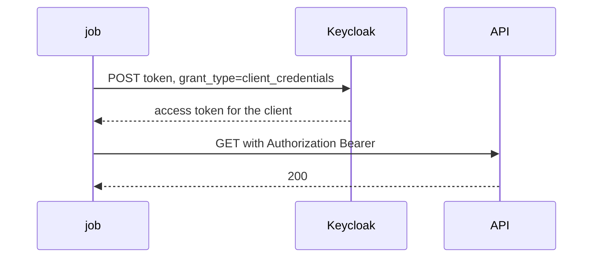

# The Client Credentials Grant

Every grant you may know starts with a person: a user signs in and the client receives tokens for that user. A backend job has no person. It still needs a token, because the API behind it will not answer a request without one. This part shows the request that gives a client a token for itself, and what the response contains.

## The token request

The client sends one `POST` request to the realm's token endpoint, `/realms/<realm>/protocol/openid-connect/token`. The body is form-encoded, and the `grant_type` is `client_credentials`. The client proves who it is with HTTP Basic authentication: the client ID as the user name and the client secret as the password.

Define the helper first. It asks Keycloak for a token as the service client you name and prints the whole response:

<!-- astrona:playground:renew -->

```sh
NAMESPACE=m2m-demo
kcadm() {
  kubectl -n "$NAMESPACE" exec -i deploy/keycloak -- \
    /opt/keycloak/bin/kcadm.sh "$@" --config /tmp/kcadm.config
}
kcadm config credentials --server http://localhost:8080 --realm master --user admin --password admin
request_token() {
  kubectl -n "$NAMESPACE" exec deploy/tester -- \
    curl -s -u "$1:$2" http://keycloak:8080/realms/inventory/protocol/openid-connect/token \
      -d grant_type=client_credentials
}
```

Request a token for `inventory-reporter`:

```sh
request_token inventory-reporter inventory-reporter-secret | jq 'keys'
```

The response is a JSON object. It holds `access_token`, `expires_in`, `token_type` and `scope`, among other fields. It does not hold a `refresh_token` or an `id_token`. A refresh token would let the client stay signed in for a user, and an ID token describes a signed-in user. A service client has neither, so when the token expires it asks again with its credentials.

## What the access token says

Decode the payload of the access token to see which claims it carries. A **claim** is one field in the token's payload:

```sh
TOKEN=$(request_token inventory-reporter inventory-reporter-secret | jq -r .access_token)
printf '%s' "$TOKEN" | jq -R 'split(".")[1] | gsub("-";"+") | gsub("_";"/") | @base64d | fromjson | {iss, azp, sub, preferred_username, clientId, typ}'
```

Read the fields. `iss` is the realm that issued the token. `azp` (authorized party) is the client that asked for it: `inventory-reporter`. `preferred_username` is `service-account-inventory-reporter`, the name of the service account user. `clientId` is also there, because Keycloak adds the client ID, the client host and the client address to a service account token with built-in mappers. There is no `email`, and no first or last name: a service account has none.



The diagram shows that the user never appears: Keycloak answers the job directly, and the job sends the token to the API.

## Why only some clients can do this

Keycloak refuses the grant unless the client has two settings. It must be confidential, so it can authenticate. And **Service accounts roles** must be on. That setting is the attribute `serviceAccountsEnabled` on the client. Send the request as the public client and see what happens:

```sh
kubectl -n "$NAMESPACE" exec deploy/tester -- \
  curl -s -o /dev/null -w '%{http_code}\n' http://keycloak:8080/realms/inventory/protocol/openid-connect/token \
    -d grant_type=client_credentials -d client_id=inventory-cli
```

The status is `400` or `401`, never `200`. A public client has no secret to prove who it is, so Keycloak will not hand it a token for itself. Now turn service accounts off for `inventory-sync`, ask again and turn them back on:

```sh
SYNC_ID=$(kcadm get clients -r inventory -q clientId=inventory-sync --fields id --format csv --noquotes | tr -d '\r')
kcadm update "clients/$SYNC_ID" -r inventory -s serviceAccountsEnabled=false
request_token inventory-sync inventory-sync-secret | jq -r '.error'
kcadm update "clients/$SYNC_ID" -r inventory -s serviceAccountsEnabled=true
request_token inventory-sync inventory-sync-secret | jq -r '.token_type'
```

The first request answers with the error `unauthorized_client`, because the client is not allowed to use the grant. The second prints `Bearer`: the client works again. The error names the client, not the secret, so you know to look at the client's settings first.

You now know the request, the response, and the two client settings that allow it. The token already says who the client is, but it says nothing yet about what the client may do. That depends on the roles of the service account, which is the next question.

## Common pitfalls

> [!WARNING]
> - **Sending the client ID and secret in the URL.** Use HTTP Basic authentication or the request body, never the query string; URLs end up in logs.
> - **Looking for a refresh token.** The response has none. Ask again with the credentials when the token expires.
> - **Turning a service client into a public client.** A public client has no secret and cannot use this grant.
> - **Reading `unauthorized_client` as a wrong secret.** It also means the service account setting is off for this client.
