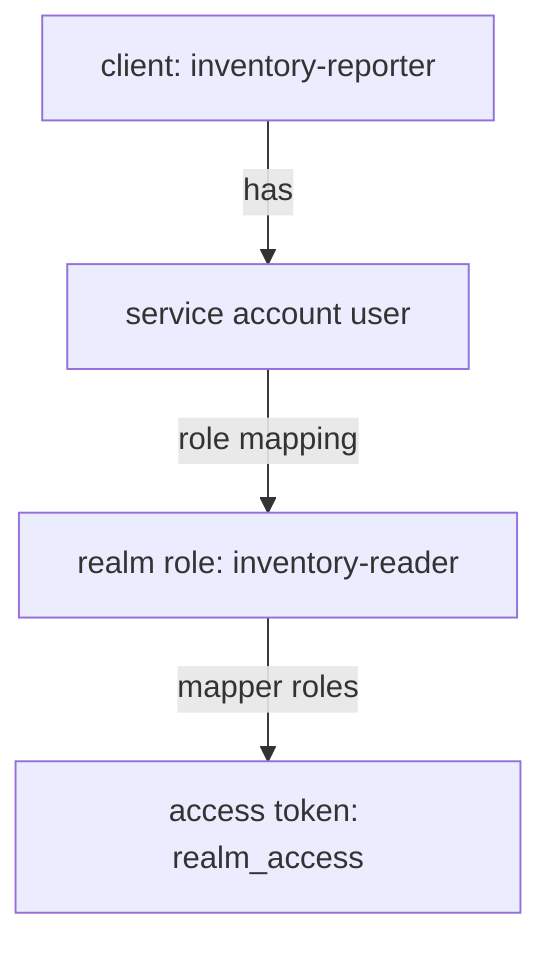

# Service Accounts And Their Roles

A token for a service client proves who the client is. The API still asks what the client may do, and it finds the answer in the roles inside the token. A service client has no person behind it, so those roles come from a special user. This part finds that user, gives it a role and checks that the role arrives in the token.

## The service account user

When you turn on **Service accounts roles** for a client, Keycloak creates a user for it. The user is called the **service account**. Its user name is `service-account-` followed by the client ID, so the service account of `inventory-reporter` is `service-account-inventory-reporter`. You cannot sign in as it with a password; it exists so that the client can hold roles and attributes like any user.

Find it with the Admin REST API, through `kcadm`:

<!-- astrona:playground:renew -->

```sh
NAMESPACE=m2m-demo
kcadm() {
  kubectl -n "$NAMESPACE" exec -i deploy/keycloak -- \
    /opt/keycloak/bin/kcadm.sh "$@" --config /tmp/kcadm.config
}
kcadm config credentials --server http://localhost:8080 --realm master --user admin --password admin
request_token() {
  kubectl -n "$NAMESPACE" exec deploy/tester -- \
    curl -s -u "$1:$2" http://keycloak:8080/realms/inventory/protocol/openid-connect/token \
      -d grant_type=client_credentials
}
decode_token() {
  jq -R 'split(".")[1] | gsub("-";"+") | gsub("_";"/") | @base64d | fromjson'
}
REPORTER_ID=$(kcadm get clients -r inventory -q clientId=inventory-reporter --fields id --format csv --noquotes | tr -d '\r')
kcadm get "clients/$REPORTER_ID/service-account-user" -r inventory --fields id,username,enabled
```

The answer shows the user name `service-account-inventory-reporter` and `enabled: true`. This is an ordinary user in the realm, so everything you know about roles applies to it.

## Roles reach the token like they do for a user

Look at the roles in a token for `inventory-reporter` before you give it any:

```sh
request_token inventory-reporter inventory-reporter-secret | jq -r .access_token | decode_token | jq '.realm_access.roles'
```

The list holds only the default roles of the realm, such as `default-roles-inventory`, `offline_access` and `uma_authorization`. It does not hold `inventory-reader`. An API that needs that role would answer `403`. Give the service account the role, with `add-roles` and the `--uusername` option that names the user:

```sh
kcadm add-roles -r inventory --uusername service-account-inventory-reporter --rolename inventory-reader
request_token inventory-reporter inventory-reporter-secret | jq -r .access_token | decode_token | jq '.realm_access.roles'
```

The new token lists `inventory-reader`. The old token, if you kept one, does not: a token is a snapshot of the roles at the moment Keycloak issued it.



The diagram shows that the client holds no role itself: the role mapping sits on the service account user, and the client scope `roles` writes it into the token.

## Give a service client only what it needs

Treat a service account like any account that can sign in to a system: give it the one role its job needs. A reporting job that only reads should not get an administration role, because a leaked secret then gives an attacker that role. You can check what a service account holds at any time:

```sh
kcadm get "users/$(kcadm get "clients/$REPORTER_ID/service-account-user" -r inventory --fields id --format csv --noquotes | tr -d '\r')/role-mappings/realm" -r inventory --fields name
```

The answer lists the roles mapped directly to the service account. You can also remove one with `remove-roles`, and the next token no longer carries it.

You can now give a service client exactly the roles it needs and prove that they arrive in the token. The role is one half of the picture; the client also has to prove who it is every time it asks. Which proof to use is a choice Keycloak lets you make per client.

## Common pitfalls

> [!WARNING]
> - **Testing with an old token.** The roles in a token are fixed when it is issued. Request a new token after every role change.
> - **Using the user name `inventory-reporter`.** The service account user is `service-account-inventory-reporter`.
> - **Giving the service account an administration role "to make it work".** Add the one role the API checks.
> - **Looking for the roles on the client.** The role mapping sits on the service account user, not on the client.

## Your mission: Repair A Service Client Lab

You can now request a token for a service client and give its service account a role. The mission starts from a service client that cannot get a token, and then gets a token without the role its API needs. You repair both.

The lab runs in its own cluster, so first pause your playground. Nothing in it is lost:

```sh
astrona stop ats-090-playground-050-01
```

Then start the lab:

```sh
astrona run --git ssh://git@github.com/astrona-io/ATS090.git -c sections/section-050/module-01/labs/lab-01
```

The task is on the next page. Solve it on your own first. When you think you are done, send it for grading:

```sh
astrona submit -c sections/section-050/module-01/labs/lab-01
```

When the lab is done, remove it and start your playground again:

```sh
astrona destroy ats-090-lab-050-01
astrona start ats-090-playground-050-01
```
