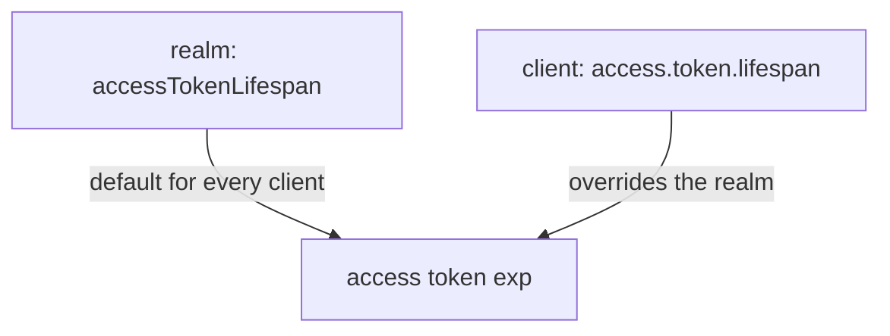

# Token And Session Lifespans

When a user signs in, Keycloak starts clocks. One clock runs on the access token, another on the session behind it, and a third on the refresh token. A user who is surprised by a sign-in prompt, or an API that accepts a token far too long, has usually met one of these clocks. This part reads the settings and changes them, then checks the effect inside a real token.

## The realm settings

Four realm settings matter most. The values are in seconds.

| Setting | Attribute on the realm | Default | What it limits |
| --- | --- | --- | --- |
| Access Token Lifespan | `accessTokenLifespan` | `300` | How long an access token is valid |
| SSO Session Idle | `ssoSessionIdleTimeout` | `1800` | How long a session lives without any refresh or new login |
| SSO Session Max | `ssoSessionMaxLifespan` | `36000` | How long a session lives in total, however active it is |
| Offline Session Idle | `offlineSessionIdleTimeout` | `2592000` | How long an offline session lives without use |

The **SSO session** is the session Keycloak keeps for a signed-in user so that other clients of the realm can sign the user in without a password. Read the settings of the playground realm:

<!-- astrona:playground:renew -->

```sh
NAMESPACE=sessions-demo
kcadm() {
  kubectl -n "$NAMESPACE" exec -i deploy/keycloak -- \
    /opt/keycloak/bin/kcadm.sh "$@" --config /tmp/kcadm.config
}
kcadm config credentials --server http://localhost:8080 --realm master --user admin --password admin
kcadm get realms/inventory --fields accessTokenLifespan,ssoSessionIdleTimeout,ssoSessionMaxLifespan,offlineSessionIdleTimeout
```

The answer lists the four values. Unless the realm was changed, they are the defaults from the table.

## Measure a token

A token states its own lifetime: `iat` is the time of issue and `exp` the time of expiry, both in seconds since 1970. Define two helpers that get a token for `alice` and decode it, then print the lifetime:

```sh
get_tokens() {
  kubectl -n "$NAMESPACE" exec deploy/tester -- \
    curl -s http://keycloak:8080/realms/inventory/protocol/openid-connect/token \
      -d grant_type=password -d client_id=inventory-cli \
      -d username=alice -d password=alice-password -d scope=openid
}
decode_token() {
  jq -R 'split(".")[1] | gsub("-";"+") | gsub("_";"/") | @base64d | fromjson'
}
get_tokens | jq -r .access_token | decode_token | jq '{lifetime: (.exp - .iat)}'
```

With the default setting the lifetime is `300` seconds. Now shorten it for the whole realm and measure again:

```sh
kcadm update realms/inventory -s accessTokenLifespan=60
get_tokens | jq -r .access_token | decode_token | jq '{lifetime: (.exp - .iat)}'
```

The lifetime is `60`. The setting applies to tokens issued after the change; a token you already hold keeps its own `exp`.

## One client with its own lifetime

Some clients need something else. The client attribute `access.token.lifespan` overrides the realm value for that client only. Set it on `inventory-cli`, and measure:

```sh
CLI_ID=$(kcadm get clients -r inventory -q clientId=inventory-cli --fields id --format csv --noquotes | tr -d '\r')
kcadm update "clients/$CLI_ID" -r inventory -s 'attributes."access.token.lifespan"=120'
get_tokens | jq -r .access_token | decode_token | jq '{lifetime: (.exp - .iat)}'
```

The lifetime is now `120`, although the realm says `60`. The client value wins. Remove the override by setting the attribute to an empty string, and put the realm back to its default:

```sh
kcadm update "clients/$CLI_ID" -r inventory -s 'attributes."access.token.lifespan"='
kcadm update realms/inventory -s accessTokenLifespan=300
```



The diagram shows that the client attribute, when it is set, replaces the realm value for that client's tokens.

You now know where each lifetime is set and how to read it from a token. A short access token is safe, but a client that must ask the user again every five minutes is not usable. The next question is how a client gets a new access token without a new sign-in.

## Common pitfalls

> [!WARNING]
> - **Checking the setting but not the token.** Read `exp - iat` in a new token; a client override can hide the realm value.
> - **Expecting a held token to change.** A new lifespan applies to tokens issued afterwards.
> - **Setting a very long access token lifespan to avoid refresh logic.** A stolen token then works just as long.
> - **Mixing up idle and max.** Idle ends a session that is not used; max ends it however busy it is.
