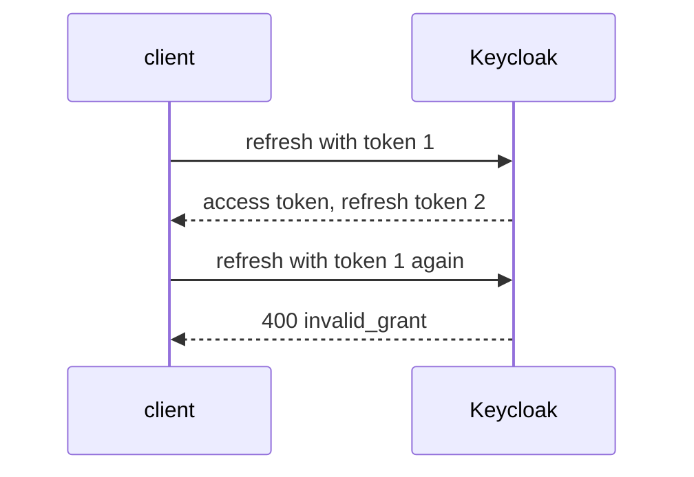

# The Refresh Token Grant And Rotation

A client that holds a refresh token can get a new access token every few minutes without bothering the user. That is convenient, and it makes the refresh token as valuable as a password until its session ends. This part refreshes a token, shows why a refresh token that can be used twice is a risk, and turns on rotation so that each refresh token works once.

## Refresh an access token

The refresh token grant is a `POST` to the token endpoint with `grant_type=refresh_token`, the client ID and the refresh token. A public client sends no secret. Keycloak checks that the session is still alive and answers with a new access token and a new refresh token.

Define the helpers, sign `alice` in and refresh:

<!-- astrona:playground:renew -->

```sh
NAMESPACE=sessions-demo
kcadm() {
  kubectl -n "$NAMESPACE" exec -i deploy/keycloak -- \
    /opt/keycloak/bin/kcadm.sh "$@" --config /tmp/kcadm.config
}
kcadm config credentials --server http://localhost:8080 --realm master --user admin --password admin
get_tokens() {
  kubectl -n "$NAMESPACE" exec deploy/tester -- \
    curl -s http://keycloak:8080/realms/inventory/protocol/openid-connect/token \
      -d grant_type=password -d client_id=inventory-cli \
      -d username=alice -d password=alice-password -d scope=openid
}
refresh_status() {
  kubectl -n "$NAMESPACE" exec deploy/tester -- \
    curl -s -o /dev/null -w '%{http_code}\n' http://keycloak:8080/realms/inventory/protocol/openid-connect/token \
      -d grant_type=refresh_token -d client_id=inventory-cli -d refresh_token="$1"
}
FIRST=$(get_tokens | jq -r .refresh_token)
refresh_status "$FIRST"
```

The status is `200`. Keycloak answered with a new access token and a new refresh token. The new refresh token belongs to the same session, so the session's idle clock restarted. A refresh token expires after the **SSO Session Idle** time, and every refresh moves that time forward, until the **SSO Session Max** time ends the session.

## Why one refresh token should work once

A refresh token is stolen like an access token: from a log, a backup or a browser. Keycloak's default is **Revoke Refresh Token** off, which means a refresh token stays usable after it was used, until it expires. An attacker with a copy and the real client can then both refresh for as long as the session lives, and nobody notices.

The realm setting `revokeRefreshToken` turns on **refresh token rotation**. Keycloak then accepts each refresh token once and answers with a new one. The setting `refreshTokenMaxReuse` says how many times the same token may be reused, and the default is `0`. Turn rotation on and test it with a new sign-in:

```sh
kcadm update realms/inventory -s revokeRefreshToken=true -s refreshTokenMaxReuse=0
FIRST=$(get_tokens | jq -r .refresh_token)
refresh_status "$FIRST"
refresh_status "$FIRST"
```

The first call prints `200`. The second uses the same refresh token again and prints `400`: Keycloak answers with the error `invalid_grant` and refuses it. Only the newest refresh token works.



The diagram shows that after one use, token 1 is dead and only token 2 works.

## When reuse is refused

Reuse of an old refresh token is a signal: two parties hold copies. With rotation on, Keycloak refuses the reuse. A real client that loses a response to a network error can also send the old token again, which is why `refreshTokenMaxReuse` exists. A value above `0` lets the same token be used that many extra times. Keep it at `0` unless a client loses responses often, because every extra use gives an attacker a chance too.

You can now keep a client signed in without a new login, and make sure a copied refresh token is of little use. Rotation does not shorten the time a session lives, so the lifetime settings of the last part still decide how long a user stays signed in.

## Common pitfalls

> [!WARNING]
> - **Reusing a refresh token in a test script and expecting `200`.** With rotation on, only the newest refresh token works. Keep the one from the last response.
> - **Setting `refreshTokenMaxReuse` above `0` to hide a client bug.** Fix the client so it stores the new refresh token.
> - **Sending a secret from a public client.** A public client sends only its client ID.
> - **Expecting a refresh to extend a session without end.** SSO Session Max ends it anyway.

## Your mission: Shorten Access Tokens And Rotate Refresh Tokens Lab

You can now set the lifetime of an access token and make refresh tokens single-use. The mission starts from a realm that issues day-long access tokens and lets refresh tokens be used again and again. You fix both and prove the result with a real refresh.

The lab runs in its own cluster, so first pause your playground. Nothing in it is lost:

```sh
astrona stop ats-090-playground-060-01
```

Then start the lab:

```sh
astrona run --git ssh://git@github.com/astrona-io/ATS090.git -c sections/section-060/module-01/labs/lab-01
```

The task is on the next page. Solve it on your own first. When you think you are done, send it for grading:

```sh
astrona submit -c sections/section-060/module-01/labs/lab-01
```

When the lab is done, remove it and start your playground again:

```sh
astrona destroy ats-090-lab-060-01
astrona start ats-090-playground-060-01
```
