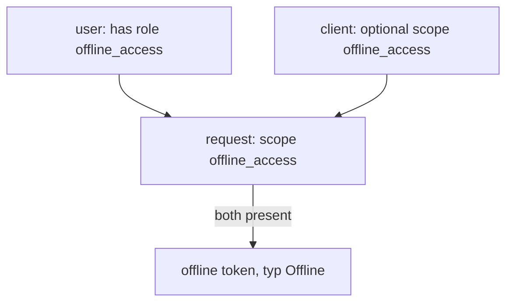

# Offline Tokens

A refresh token lives only as long as its SSO session, and the session ends when the user is idle for 30 minutes by default. That fits a user at a browser. It does not fit a mobile application that syncs data overnight, or a command-line tool that a person signs in to once a month. For work that must continue while the user is away, Keycloak offers the offline token.

## What an offline token is

An **offline token** is a refresh token that is not tied to the user's SSO session. A client asks for it by adding the scope `offline_access` to the sign-in request. The user must hold the realm role `offline_access`, which every user has through the default roles. Keycloak then stores an **offline session** in its database, where it survives a restart of Keycloak and the end of the SSO session.

Define the helpers, then ask for an offline token and read its type:

<!-- astrona:playground:renew -->

```sh
NAMESPACE=sessions-demo
kcadm() {
  kubectl -n "$NAMESPACE" exec -i deploy/keycloak -- \
    /opt/keycloak/bin/kcadm.sh "$@" --config /tmp/kcadm.config
}
kcadm config credentials --server http://localhost:8080 --realm master --user admin --password admin
get_tokens() {
  kubectl -n "$NAMESPACE" exec deploy/tester -- \
    curl -s http://keycloak:8080/realms/inventory/protocol/openid-connect/token \
      -d grant_type=password -d client_id=inventory-cli \
      -d username=alice -d password=alice-password -d "scope=$1"
}
decode_token() {
  jq -R 'split(".")[1] | gsub("-";"+") | gsub("_";"/") | @base64d | fromjson'
}
get_tokens "openid offline_access" | jq -r .refresh_token | decode_token | jq '{typ, scope}'
get_tokens openid | jq -r .refresh_token | decode_token | jq '{typ}'
```

The first refresh token has the type `Offline` and its scope includes `offline_access`. The second, requested without the scope, has the type `Refresh`. The type tells you which kind of session stands behind the token.

## Where the lifetime comes from

An offline token has no SSO idle clock. It has its own: **Offline Session Idle**, the realm attribute `offlineSessionIdleTimeout`, which is 30 days by default. Each refresh with the offline token resets it. Without use, the offline session ends after 30 days. A second limit, **Offline Session Max**, ends the session after a fixed time however often it is used. It is off by default and is switched on with `offlineSessionMaxLifespanEnabled`, with the length in `offlineSessionMaxLifespan`. Read the idle setting and the offline sessions a client holds:

```sh
kcadm get realms/inventory --fields offlineSessionIdleTimeout,offlineSessionMaxLifespanEnabled
CLI_ID=$(kcadm get clients -r inventory -q clientId=inventory-cli --fields id --format csv --noquotes | tr -d '\r')
kcadm get "clients/$CLI_ID/offline-sessions" -r inventory --fields username,lastAccess
```

The first command prints the idle timeout `2592000` and the max switch `false`. The second lists the offline session that you created above, with the user name `alice`.

## Who is allowed to ask

Two things must hold for the request to succeed: the client must have `offline_access` in its client scopes, and the user must have the role. The scope `offline_access` is an **optional** client scope of a new client, which means a client gets it only when the request names it. If an administrator removes the scope from a client, a request for `offline_access` gives no offline token, and the application has no long-lived access. Likewise, a user without the `offline_access` role cannot get one.

An offline token is a long-lived credential, so treat it like a password. Keep the idle time as short as the use case allows. An administrator can end the offline session of a user, and a user can revoke what an application holds in the Account Console.



The diagram shows that the user's role and the client's scope must both be there.

You now know how to ask for a token that outlives the browser session, which setting limits it, and the two conditions for getting one. A long-lived token must be easy to end, so the last part looks at how sessions and tokens are stopped on purpose.

## Common pitfalls

> [!WARNING]
> - **Using offline tokens in a browser application.** A browser has no safe place for such a long-lived credential; use a normal session.
> - **Forgetting the scope.** A refresh token without `offline_access` in the request is a normal refresh token.
> - **Setting a very long idle time "to be safe".** A token nobody uses for months should expire.
> - **Removing `offline_access` from the realm's default roles.** Users then cannot get offline tokens at all.
