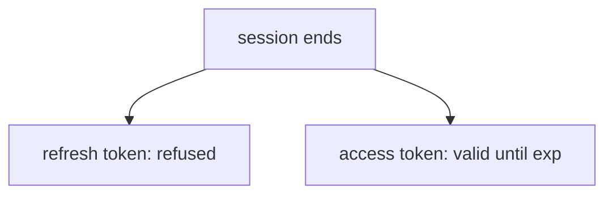

# How Keycloak Sessions End

When `alice` signs in, Keycloak creates a **user session** and ties every token it issues to it. A session ends in only a few ways. Knowing them tells you what a refresh token can still do, and what an access token can still do, after each one.

## The five ways a session ends

| How | Who starts it | What happens |
| --- | --- | --- |
| Logout request | The application | Keycloak removes the session of that sign-in |
| Idle timeout | Time | The session had no refresh for longer than the SSO Session Idle limit |
| Max lifespan | Time | The session is older than the SSO Session Max limit, whatever its activity |
| Admin action | An administrator | The session of one user, or all sessions, are removed |
| Realm or user change | An administrator | Disabling the user, or a password reset with the option to log out, removes sessions |

In every case the session object disappears. A refresh token that points to it stops working, and the next refresh answers `400` with `invalid_grant`.

## What stays valid

An **access token** is a signed JWT. An API that validates it locally checks only the signature, the issuer, the audience and the expiry. It does not ask Keycloak about the session. So an access token issued before the logout stays valid at such an API until its `exp` time. This is why access tokens are short.

Define the helpers and see it:

<!-- astrona:playground:renew -->

```sh
NAMESPACE=logout-demo
kcadm() {
  kubectl -n "$NAMESPACE" exec -i deploy/keycloak -- \
    /opt/keycloak/bin/kcadm.sh "$@" --config /tmp/kcadm.config
}
kcadm config credentials --server http://localhost:8080 --realm master --user admin --password admin
get_tokens() {
  kubectl -n "$NAMESPACE" exec deploy/tester -- \
    curl -s http://keycloak:8080/realms/inventory/protocol/openid-connect/token \
      -d grant_type=password -d client_id=inventory-cli \
      -d username=alice -d password=alice-password -d scope=openid
}
refresh_status() {
  kubectl -n "$NAMESPACE" exec deploy/tester -- \
    curl -s -o /dev/null -w '%{http_code}\n' http://keycloak:8080/realms/inventory/protocol/openid-connect/token \
      -d grant_type=refresh_token -d client_id=inventory-cli -d refresh_token="$1"
}
TOKENS=$(get_tokens)
REFRESH=$(printf '%s' "$TOKENS" | jq -r .refresh_token)
USER_ID=$(kcadm get users -r inventory -q username=alice --fields id --format csv --noquotes | tr -d '\r')
kcadm get "users/$USER_ID/sessions" -r inventory --fields id,start,lastAccess
```

The answer lists one session. Now end it with the admin API and refresh:

```sh
kcadm create "users/$USER_ID/logout" -r inventory -b '{}'
kcadm get "users/$USER_ID/sessions" -r inventory
refresh_status "$REFRESH"
```

The session list is empty and the refresh answers `400`. The access token in `$TOKENS` still decodes and still has a future `exp`: Keycloak did not take it back, because it never keeps the access token.



The diagram shows that a session ending stops refreshing, but does not stop an access token that was already issued.

## Two limits that end sessions by time

The realm settings **SSO Session Idle** (`ssoSessionIdleTimeout`, default 1800 seconds) and **SSO Session Max** (`ssoSessionMaxLifespan`, default 36000 seconds) end sessions without anyone asking. Idle counts from the last refresh or sign-in activity. Max counts from the start, whatever the activity. A shorter value reduces the time a stolen refresh token is useful, at the price of more sign-ins.

You now know how a session ends and what an already issued access token can still do. The next part covers the endpoint a browser application uses to end its own session.

## Common pitfalls

> [!WARNING]
> - **Expecting a logout to stop access tokens.** Only a session-aware check, such as introspection, notices the logout before expiry.
> - **Testing logout with an access token only.** The logout request needs the refresh token or an ID token, not the access token.
> - **Setting the idle limit longer than the max limit.** The max limit still ends the session.
