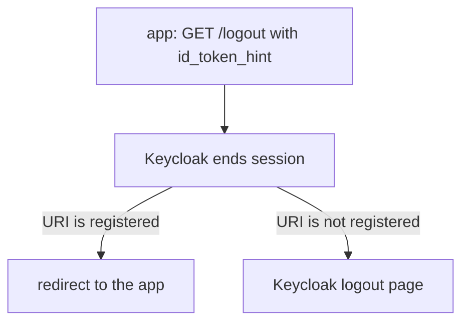

# RP-Initiated Logout And Post-Logout Redirects

An application that wants to sign its user out sends the user to Keycloak, or calls Keycloak directly. OpenID Connect names this **RP-initiated logout**: the relying party (RP), your application, starts the logout. This part covers both forms and the setting that decides where the user lands afterwards.

## The logout endpoint

The endpoint is `/realms/<realm>/protocol/openid-connect/logout`. Its address is the `end_session_endpoint` of the discovery document:

<!-- astrona:playground:renew -->

```sh
NAMESPACE=logout-demo
kcadm() {
  kubectl -n "$NAMESPACE" exec -i deploy/keycloak -- \
    /opt/keycloak/bin/kcadm.sh "$@" --config /tmp/kcadm.config
}
kcadm config credentials --server http://localhost:8080 --realm master --user admin --password admin
get_tokens() {
  kubectl -n "$NAMESPACE" exec deploy/tester -- \
    curl -s http://keycloak:8080/realms/inventory/protocol/openid-connect/token \
      -d grant_type=password -d client_id=inventory-cli \
      -d username=alice -d password=alice-password -d scope=openid
}
kubectl -n "$NAMESPACE" exec deploy/tester -- \
  curl -s http://keycloak:8080/realms/inventory/.well-known/openid-configuration | jq -r .end_session_endpoint
```

## Logout from the back end

A server-side or native application that holds the refresh token logs out with a `POST`. The body carries the client ID and the refresh token. A public client sends no secret:

```sh
REFRESH=$(get_tokens | jq -r .refresh_token)
kubectl -n "$NAMESPACE" exec deploy/tester -- \
  curl -s -o /dev/null -w '%{http_code}\n' http://keycloak:8080/realms/inventory/protocol/openid-connect/logout \
    -d client_id=inventory-cli -d refresh_token="$REFRESH"
```

Keycloak answers `204` and removes the session. A confidential client adds its client authentication to the same request.

## Logout through the browser

A browser application sends the user to the endpoint with a `GET`. The parameters are:

| Parameter | Meaning |
| --- | --- |
| `id_token_hint` | The ID token that the application received at sign-in. It tells Keycloak which session to end |
| `client_id` | The client, used when no `id_token_hint` is sent |
| `post_logout_redirect_uri` | Where Keycloak sends the browser after the logout |
| `state` | A value that Keycloak returns on the redirect |

Without a `post_logout_redirect_uri`, the user sees the Keycloak page that says they are logged out. With one, Keycloak redirects the browser after it has removed the session.

## Allow the redirect target

Keycloak does not redirect to any address in the request. The address must match a **Valid post logout redirect URIs** entry of the client, kept in the client attribute `post.logout.redirect.uris`. Several entries are separated by `##`. Set one and read it back:

```sh
CLI_ID=$(kcadm get clients -r inventory -q clientId=inventory-cli --fields id --format csv --noquotes | tr -d '\r')
kcadm update "clients/$CLI_ID" -r inventory -s 'attributes."post.logout.redirect.uris"=https://app.example.com/signed-out'
kcadm get "clients/$CLI_ID" -r inventory --fields attributes
```

A request with `post_logout_redirect_uri=https://evil.example/` does not match and Keycloak refuses to redirect. A value of `+` makes the client reuse its valid redirect URIs, and `*` allows any address, which turns the endpoint into an open redirect. Always list exact addresses.



The diagram shows that the redirect happens only for registered addresses.

You can now end a session from an application and send the user back to it. The other applications in the same session do not know yet, and the next part covers how Keycloak tells them.

## Common pitfalls

> [!WARNING]
> - **Registering `*` as a post logout redirect URI.** It lets an attacker send users anywhere after a logout.
> - **Sending no `id_token_hint` and no `client_id`.** Keycloak cannot tell which client asks, and shows a confirmation page.
> - **Logging out by deleting the application's own cookie only.** The Keycloak session stays and the next sign-in is silent.
> - **Using the access token in the logout request.** Send the refresh token or the ID token.
