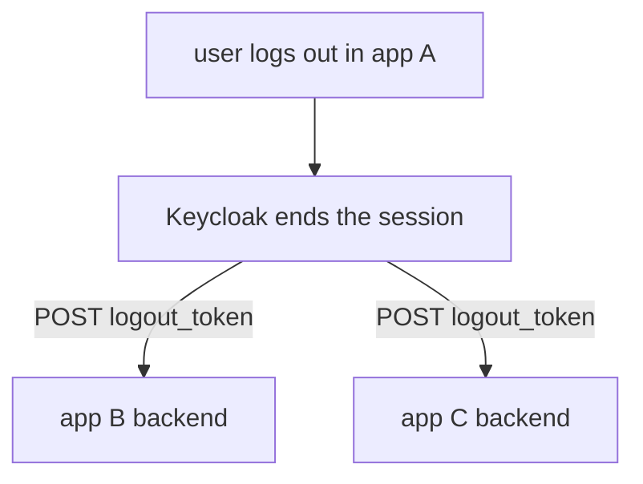

# Back-Channel And Front-Channel Logout

One user session can serve several applications. When the user signs out of one of them, the others still hold their own local sessions, cookies and tokens. Keycloak can tell them to end theirs. There are two ways, and they differ in who carries the message.

## Front-channel logout

With **front-channel logout** the browser carries the message. Keycloak shows a page that loads the front-channel logout URL of each client in a hidden frame, and each application clears its session when its URL is loaded. The client setting is `frontchannelLogout`, with the URL in the attribute `frontchannel.logout.url`. It needs the browser to stay on the page, and browsers that block third-party cookies in frames can break it.

## Back-channel logout

With **back-channel logout** Keycloak sends the message itself, as a server-to-server `POST`, so it works without a browser. The client setting is the **Backchannel logout URL**, the attribute `backchannel.logout.url`. Keycloak posts a form with one field, `logout_token`, to that URL.

The logout token is a signed JWT. Its claims include the issuer `iss`, the audience `aud` (the client), `iat`, a unique `jti`, and an `events` claim whose key is `http://schemas.openid.net/event/backchannel-logout`. It also carries `sub` or `sid`. The `sid` claim is the session ID. The application validates the token like any other JWT, finds the local session that has this `sid`, and ends it. It answers `200` or `204` when done.

Define the helpers and set a back-channel URL on the client:

<!-- astrona:playground:renew -->

```sh
NAMESPACE=logout-demo
kcadm() {
  kubectl -n "$NAMESPACE" exec -i deploy/keycloak -- \
    /opt/keycloak/bin/kcadm.sh "$@" --config /tmp/kcadm.config
}
kcadm config credentials --server http://localhost:8080 --realm master --user admin --password admin
CLI_ID=$(kcadm get clients -r inventory -q clientId=inventory-cli --fields id --format csv --noquotes | tr -d '\r')
kcadm update "clients/$CLI_ID" -r inventory \
  -s 'attributes."backchannel.logout.url"=http://app-backend.logout-demo.svc:8080/backchannel-logout' \
  -s 'attributes."backchannel.logout.session.required"=true' \
  -s 'attributes."backchannel.logout.revoke.offline.tokens"=false'
kcadm get "clients/$CLI_ID" -r inventory --fields attributes
```

The setting `backchannel.logout.session.required` makes Keycloak include the `sid` claim, so the application can find the one session to end. Without it, only `sub` is sent, and the application would end all sessions of that user. The setting `backchannel.logout.revoke.offline.tokens` decides whether the logout also revokes the offline tokens of the client; offline tokens are otherwise unaffected.



The diagram shows Keycloak notifying each client that has a back-channel URL.

## Which to use

Prefer back-channel logout. It does not depend on the browser, and it also fires when an administrator ends a session or a session expires. Front-channel logout fits applications that cannot expose a server endpoint, such as a pure browser application, and it runs only when the logout starts in a browser. Back-channel needs the application to be reachable from Keycloak; inside a cluster that means a Service address that Keycloak can resolve.

You now know how the other applications learn about a logout. The last part covers the tools an operator uses to see and end sessions.

## Common pitfalls

> [!WARNING]
> - **Setting a back-channel URL that Keycloak cannot reach.** Keycloak logs a failure and the application keeps its session.
> - **Not validating the logout token.** Anyone could post a fake token and sign users out.
> - **Leaving `session.required` off with several sessions per user.** The application then ends every session of the user.
> - **Relying on front-channel logout alone.** An expired or admin-ended session sends no front-channel message.
