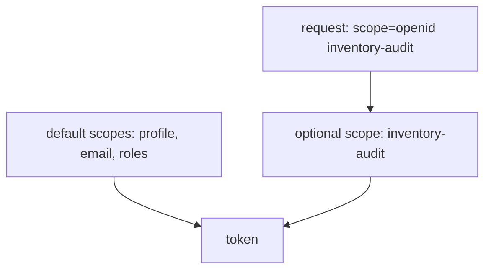

# Client Scopes: Default And Optional

Every client in a realm shares some behaviour: they all put the user name into the token, they all list roles, they all know the `email` claim. Keycloak does not copy these settings into each client. It keeps them in client scopes and assigns the scopes to clients. This part lists the scopes of a realm, shows how a client holds them as default or optional, and uses the `scope` parameter to change a token.

## What a client scope holds

A client scope has a name, a protocol (here `openid-connect`), a set of protocol mappers and role scope mappings, and a few attributes such as **Include in token scope**. When a client uses the scope, its mappers run for every token of that client. The realm has several built-in scopes: `profile`, `email`, `roles`, `web-origins`, `acr` and others.

Define the helpers and list the scopes:

<!-- astrona:playground:renew -->

```sh
NAMESPACE=scopes-demo
kcadm() {
  kubectl -n "$NAMESPACE" exec -i deploy/keycloak -- \
    /opt/keycloak/bin/kcadm.sh "$@" --config /tmp/kcadm.config
}
kcadm config credentials --server http://localhost:8080 --realm master --user admin --password admin
kcadm get client-scopes -r inventory --fields name,protocol
```

The answer lists the built-in scopes with the protocol `openid-connect`, together with `saml_organization` and other scopes that this module does not use.

## Default and optional

A client holds each scope in one of two ways. A **default** client scope applies to every token request of the client, whatever the request says. An **optional** client scope applies only when the request names it in the `scope` parameter. Read the lists for `inventory-cli`:

```sh
CLI_ID=$(kcadm get clients -r inventory -q clientId=inventory-cli --fields id --format csv --noquotes | tr -d '\r')
kcadm get "clients/$CLI_ID/default-client-scopes" -r inventory --fields name
kcadm get "clients/$CLI_ID/optional-client-scopes" -r inventory --fields name
```

The default list holds scopes such as `profile`, `email`, `roles` and `web-origins`. The optional list holds `address`, `phone`, `offline_access` and `microprofile-jwt`. The distinction matters for sensitive data: put a claim in an optional scope, and only requests that ask for it get the claim.

## Create a scope and use it

Create a client scope `inventory-audit` with a mapper that adds the claim `audit` with the fixed value `true`. A **hardcoded claim mapper** writes the same value into every token that uses the scope:

```sh
kcadm create client-scopes -r inventory -s name=inventory-audit -s protocol=openid-connect \
  -s 'attributes."include.in.token.scope"=true' -s 'attributes."display.on.consent.screen"=false'
AUDIT_ID=$(kcadm get client-scopes -r inventory --fields id,name --format csv --noquotes | tr -d '\r' | awk -F, '$2 == "inventory-audit" {print $1}')
kcadm create "client-scopes/$AUDIT_ID/protocol-mappers/models" -r inventory \
  -s name=audit-claim -s protocol=openid-connect -s protocolMapper=oidc-hardcoded-claim-mapper \
  -s 'config."claim.name"=audit' -s 'config."claim.value"=true' -s 'config."jsonType.label"=boolean' \
  -s 'config."access.token.claim"=true' -s 'config."id.token.claim"=false' -s 'config."userinfo.token.claim"=false'
kcadm update "clients/$CLI_ID/optional-client-scopes/$AUDIT_ID" -r inventory
```

The scope is now an optional scope of `inventory-cli`. Define a helper that signs `alice` in with the scope you give it, and compare two requests:

```sh
decode_token() {
  jq -R 'split(".")[1] | gsub("-";"+") | gsub("_";"/") | @base64d | fromjson'
}
get_access_token() {
  kubectl -n "$NAMESPACE" exec deploy/tester -- \
    curl -s http://keycloak:8080/realms/inventory/protocol/openid-connect/token \
      -d grant_type=password -d client_id=inventory-cli \
      -d username=alice -d password=alice-password --data-urlencode "scope=$1" \
  | jq -r .access_token
}
get_access_token openid | decode_token | jq '{audit, scope}'
get_access_token "openid inventory-audit" | decode_token | jq '{audit, scope}'
```

The first token has no `audit` claim. The second has `audit: true`, and its `scope` claim lists `inventory-audit`. The scope parameter switched the optional scope on for that request only.



The diagram shows that default scopes always apply, and an optional scope applies only when the request names it.

## Making the scope default

An application you cannot change may never send the extra scope. Then the scope must be a default scope of the client. Move it: remove the optional assignment and add the default one.

```sh
kcadm delete "clients/$CLI_ID/optional-client-scopes/$AUDIT_ID" -r inventory
kcadm update "clients/$CLI_ID/default-client-scopes/$AUDIT_ID" -r inventory
get_access_token openid | decode_token | jq '{audit}'
```

Now the token has `audit: true` without any scope parameter. You can see why the choice matters: a default scope costs the client nothing to use but shows its claim to every request, and an optional scope needs the application to ask.

You now know how a client gets its scopes and how a request changes the result. The scope you built carries a mapper, and so far you have only used a mapper without looking at how it is configured. The next part looks at mappers in detail.

## Common pitfalls

> [!WARNING]
> - **Assigning a scope as optional and expecting the claim.** The claim appears only when the request names the scope.
> - **Adding a client scope but not assigning it to the client.** An unassigned scope does nothing.
> - **Testing with a token from before the change.** Request a new token.
> - **Putting sensitive claims in a default scope.** Every client request then receives them.
