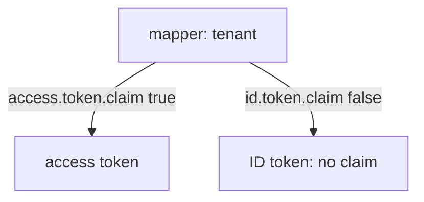

# Protocol Mappers And Custom Claims

The API needs to know which group a caller belongs to, and which tenant it works for. Keycloak knows the first from the user's group membership and the second from nowhere, because it is a fixed value. A protocol mapper turns such a fact into a claim. This part adds three mappers, shows the switches that decide which token receives the claim, and reads the result in a real token.

## The anatomy of a mapper

A protocol mapper has a name, a mapper type and a configuration. The mapper type decides where the value comes from. The configuration decides the claim name and where the claim goes. Four switches control where it goes: **Add to access token**, **Add to ID token**, **Add to userinfo** and **Add to token introspection**. A mapper whose switch for a token is off writes nothing into that token.

You can attach a mapper to a client scope, as in the last part, or directly to a client, where it lives in the client's dedicated scope. Define the helpers, then add a mapper for the group names of the user to the dedicated scope of `inventory-cli`:

<!-- astrona:playground:renew -->

```sh
NAMESPACE=scopes-demo
kcadm() {
  kubectl -n "$NAMESPACE" exec -i deploy/keycloak -- \
    /opt/keycloak/bin/kcadm.sh "$@" --config /tmp/kcadm.config
}
kcadm config credentials --server http://localhost:8080 --realm master --user admin --password admin
decode_token() {
  jq -R 'split(".")[1] | gsub("-";"+") | gsub("_";"/") | @base64d | fromjson'
}
get_tokens() {
  kubectl -n "$NAMESPACE" exec deploy/tester -- \
    curl -s http://keycloak:8080/realms/inventory/protocol/openid-connect/token \
      -d grant_type=password -d client_id=inventory-cli \
      -d username=alice -d password=alice-password -d scope=openid
}
CLI_ID=$(kcadm get clients -r inventory -q clientId=inventory-cli --fields id --format csv --noquotes | tr -d '\r')
kcadm create "clients/$CLI_ID/protocol-mappers/models" -r inventory \
  -s name=groups -s protocol=openid-connect -s protocolMapper=oidc-group-membership-mapper \
  -s 'config."claim.name"=groups' -s 'config."full.path"=false' \
  -s 'config."access.token.claim"=true' -s 'config."id.token.claim"=true' -s 'config."userinfo.token.claim"=true'
get_tokens | jq -r .access_token | decode_token | jq '{groups}'
```

The token has `groups` with the value `["logistics"]`. The mapper type is `oidc-group-membership-mapper`. With `full.path` set to `false` the claim holds the group name; with `true` it holds the path, `/logistics`.

## A claim from a user property

The mapper type `oidc-usermodel-property-mapper` copies a property of the user, such as `email`, `firstName` or `username`, into a claim with the name you choose:

```sh
kcadm create "clients/$CLI_ID/protocol-mappers/models" -r inventory \
  -s name=contact -s protocol=openid-connect -s protocolMapper=oidc-usermodel-property-mapper \
  -s 'config."user.attribute"=email' -s 'config."claim.name"=contact' -s 'config."jsonType.label"=String' \
  -s 'config."access.token.claim"=true' -s 'config."id.token.claim"=true' -s 'config."userinfo.token.claim"=true'
get_tokens | jq -r .access_token | decode_token | jq '{contact}'
```

The claim `contact` holds the email address `alice@example.com`. A similar type, `oidc-usermodel-attribute-mapper`, copies a custom user attribute, but a custom attribute must first be declared in the realm's user profile before Keycloak stores it.

## A fixed claim in one token only

The hardcoded claim mapper, `oidc-hardcoded-claim-mapper`, writes a fixed value. Add a `tenant` claim to the access token only, and compare the two tokens:

```sh
kcadm create "clients/$CLI_ID/protocol-mappers/models" -r inventory \
  -s name=tenant -s protocol=openid-connect -s protocolMapper=oidc-hardcoded-claim-mapper \
  -s 'config."claim.name"=tenant' -s 'config."claim.value"=outpost' -s 'config."jsonType.label"=String' \
  -s 'config."access.token.claim"=true' -s 'config."id.token.claim"=false' -s 'config."userinfo.token.claim"=false'
TOKENS=$(get_tokens)
printf '%s' "$TOKENS" | jq -r .access_token | decode_token | jq '{tenant}'
printf '%s' "$TOKENS" | jq -r .id_token | decode_token | jq '{tenant, groups}'
```

The access token has `tenant: "outpost"`. The ID token has no `tenant`, because its switch is off, but it has `groups`, because that mapper writes to both tokens. The same mapper can therefore give a different result in each token, and the switches are the first thing to check when a claim is missing.



The diagram shows that one mapper writes into a token only where its switch is on.

You now know how to put a group, a property and a fixed value into a token, and where to look when one is missing. A mapper adds claims; it does not decide which roles the token carries. That is a separate setting, and the next part covers it.

## Common pitfalls

> [!WARNING]
> - **Forgetting the switches.** A mapper with `access.token.claim` off adds nothing to the access token.
> - **Using `full.path` and comparing with a group name.** The claim then holds `/logistics`, not `logistics`.
> - **Mapping a custom user attribute that the user profile does not declare.** Keycloak does not store it, so the claim stays empty.
> - **Two mappers with the same claim name.** The later one can overwrite the first; give each claim its own name.

## Your mission: Add Group And Tenant Claims To A Client Lab

You can now add claims to a client's tokens and choose which token gets each one. The mission starts from a client whose tokens carry neither claim that a new API requires. You add both mappers with the right switches.

The lab runs in its own cluster, so first pause your playground. Nothing in it is lost:

```sh
astrona stop ats-090-playground-080-01
```

Then start the lab:

```sh
astrona run --git ssh://git@github.com/astrona-io/ATS090.git -c sections/section-080/module-01/labs/lab-01
```

The task is on the next page. Solve it on your own first. When you think you are done, send it for grading:

```sh
astrona submit -c sections/section-080/module-01/labs/lab-01
```

When the lab is done, remove it and start your playground again:

```sh
astrona destroy ats-090-lab-080-01
astrona start ats-090-playground-080-01
```
