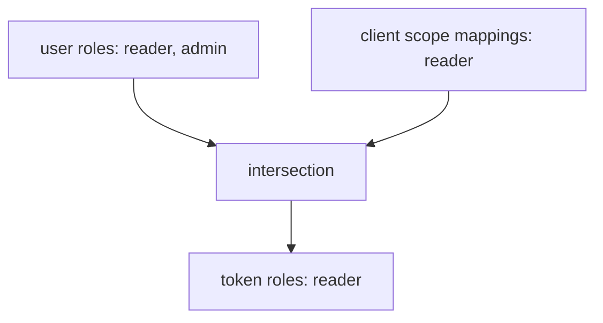

# Roles In Tokens: Full Scope And Scope Mappings

A user can hold many roles, and a client rarely needs all of them. A token that carries every role of the user works as a master key for whoever steals it, and it tells every API more than it should know. Keycloak limits the roles in a token with a client setting called Full Scope Allowed and with role scope mappings. This part shows the default behaviour and then narrows it.

## Full Scope Allowed

By default a client has **Full Scope Allowed** on, in the client attribute `fullScopeAllowed`. The token then contains every role the user holds. Look at the roles in a token for `alice`, who has `inventory-reader` and `inventory-admin`:

<!-- astrona:playground:renew -->

```sh
NAMESPACE=scopes-demo
kcadm() {
  kubectl -n "$NAMESPACE" exec -i deploy/keycloak -- \
    /opt/keycloak/bin/kcadm.sh "$@" --config /tmp/kcadm.config
}
kcadm config credentials --server http://localhost:8080 --realm master --user admin --password admin
decode_token() {
  jq -R 'split(".")[1] | gsub("-";"+") | gsub("_";"/") | @base64d | fromjson'
}
get_access_token() {
  kubectl -n "$NAMESPACE" exec deploy/tester -- \
    curl -s http://keycloak:8080/realms/inventory/protocol/openid-connect/token \
      -d grant_type=password -d client_id=inventory-cli \
      -d username=alice -d password=alice-password -d scope=openid \
  | jq -r .access_token
}
get_access_token | decode_token | jq '.realm_access.roles'
```

The list holds `inventory-reader`, `inventory-admin` and the default roles of the realm. A client that only reads the inventory has no use for `inventory-admin`, and an API that trusts the token would see an administrator.

## Turn it off

Set `fullScopeAllowed` to `false`. The token then holds only the roles that the client may use, and by default that is none:

```sh
CLI_ID=$(kcadm get clients -r inventory -q clientId=inventory-cli --fields id --format csv --noquotes | tr -d '\r')
kcadm update "clients/$CLI_ID" -r inventory -s fullScopeAllowed=false
get_access_token | decode_token | jq '.realm_access'
```

The answer is `null`: the token has no realm roles, although `alice` still has them. An API that needs `inventory-reader` would now answer `403`.

## Allow exactly one role

A **role scope mapping** lists the roles a client or client scope may put into tokens. Add one for `inventory-reader` to the client. The REST body is a list of role objects, so first read the role's id:

```sh
READER_ID=$(kcadm get roles/inventory-reader -r inventory --fields id --format csv --noquotes | tr -d '\r')
kcadm create "clients/$CLI_ID/scope-mappings/realm" -r inventory -b "[{\"id\":\"$READER_ID\",\"name\":\"inventory-reader\"}]"
get_access_token | decode_token | jq '.realm_access.roles'
```

The token lists `inventory-reader` and not `inventory-admin`. The rule behind it: a role reaches the token only if the user has the role **and** the client's scope allows it. Scope mappings can sit on the client or on any client scope the client uses, and the token gets the union.



The diagram shows that the token holds the roles that appear in both the user's roles and the client's scope mappings.

## Which setting for which goal

Use Full Scope Allowed only for clients that act as the user without limits, such as a first-party administration console. For every other client, turn it off and map the few roles the application needs. The trade-off is upkeep: each new role an API needs must be added to the scope mapping, or the token will not carry it and the API will answer `403`.

You now know how to keep a token small and why a role can be missing from a token even if the user holds it. The remaining question is where an application should read these claims: in which token, and from which endpoint.

## Common pitfalls

> [!WARNING]
> - **Turning off Full Scope Allowed without adding any scope mapping.** The token has no roles and every role check fails.
> - **Adding a scope mapping and expecting the user to gain the role.** The user must hold the role too.
> - **Looking for the fix in the user's roles when a role is missing from the token.** Check the client's scope mappings first.
> - **Leaving Full Scope Allowed on for public clients.** A leaked token then reveals every role of the user.
