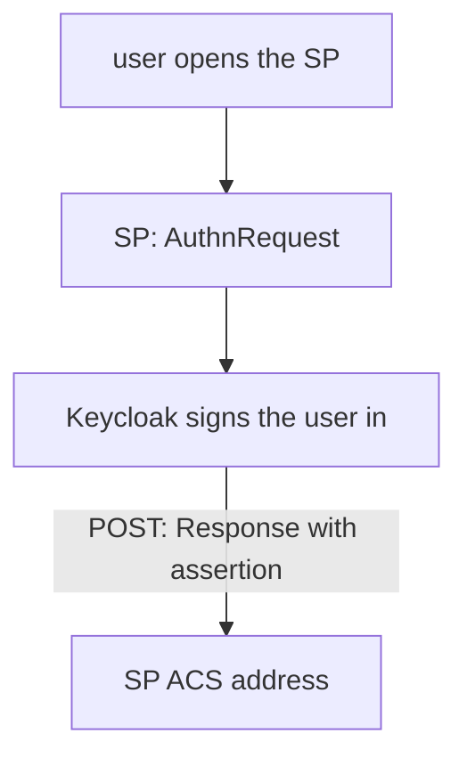

# SAML Basics And The Keycloak Descriptor

A user opens a billing application. The application does not know the user, so it sends the browser to Keycloak with a request to authenticate. Keycloak signs the user in and sends the browser back with a signed assertion. The application checks the signature and creates its own session. That is the whole SAML web browser single sign-on.

## The parts

| Term | Meaning |
| --- | --- |
| Identity provider (IdP) | Keycloak. It authenticates the user and issues the assertion |
| Service provider (SP) | The application. It trusts assertions from the IdP |
| Entity ID | A unique name of a party, often a URL or a `urn:` string |
| Assertion | A signed XML statement: who the user is, and attributes such as roles |
| Assertion consumer service (ACS) | The SP address that receives the assertion |
| Binding | How a message travels over HTTP: **Redirect** puts it in the URL, **POST** puts it in an auto-submitted form |

In the flow that starts at the SP (**SP-initiated**), the SP sends an `AuthnRequest` to Keycloak through the redirect or POST binding. Keycloak answers with a `Response` that holds the assertion, through the POST binding, to the ACS address. A flow that starts at Keycloak without a request is **IdP-initiated**.



The diagram shows the SP-initiated flow: the request goes to Keycloak and the signed answer goes to the ACS address.

## The IdP descriptor

Both sides exchange their settings in an XML document called **metadata** or a **descriptor**. Keycloak publishes its own at `/realms/<realm>/protocol/saml/descriptor`. A service provider imports it to learn the IdP entity ID, the single sign-on addresses and the signing certificate. Define the helpers and fetch it:

<!-- astrona:playground:renew -->

```sh
NAMESPACE=saml-demo
kcadm() {
  kubectl -n "$NAMESPACE" exec -i deploy/keycloak -- \
    /opt/keycloak/bin/kcadm.sh "$@" --config /tmp/kcadm.config
}
kcadm config credentials --server http://localhost:8080 --realm master --user admin --password admin
kubectl -n "$NAMESPACE" exec deploy/tester -- \
  curl -s http://keycloak:8080/realms/inventory/protocol/saml/descriptor | head -c 600
```

The answer is XML that starts with an `EntityDescriptor` element. Its `entityID` is the realm address, for example `http://keycloak:8080/realms/inventory`. The descriptor also lists `SingleSignOnService` elements, one for each binding, and a `KeyDescriptor` with the realm's signing certificate. Search for them:

```sh
kubectl -n "$NAMESPACE" exec deploy/tester -- \
  curl -s http://keycloak:8080/realms/inventory/protocol/saml/descriptor | grep -o '<md:SingleSignOnService[^>]*>'
```

The same descriptor is what you give to every SAML application. If the realm's signing key is rotated, the applications must import the descriptor again, or they reject assertions.

## OIDC and SAML side by side

| Question | OpenID Connect | SAML 2.0 |
| --- | --- | --- |
| Token format | JWT | XML assertion |
| Typical clients | Single page applications, mobile applications, APIs | Older and commercial enterprise applications |
| Metadata | Discovery document (JSON) | Descriptor (XML) |
| Client name | `clientId` | Entity ID, stored as `clientId` in Keycloak |

In Keycloak a SAML client is a client with the protocol `saml`. Its `clientId` is the entity ID of the service provider.

You now know the flow and where the IdP publishes its side. The next part creates the service provider side in Keycloak.

## Common pitfalls

> [!WARNING]
> - **Expecting a SAML client to use OAuth settings.** Redirect URIs and secrets work differently for SAML.
> - **Reading the descriptor of the wrong realm.** Each realm has its own entity ID and certificate.
> - **Keeping an old descriptor in the SP after a key rotation.** The SP then rejects the new signatures.
