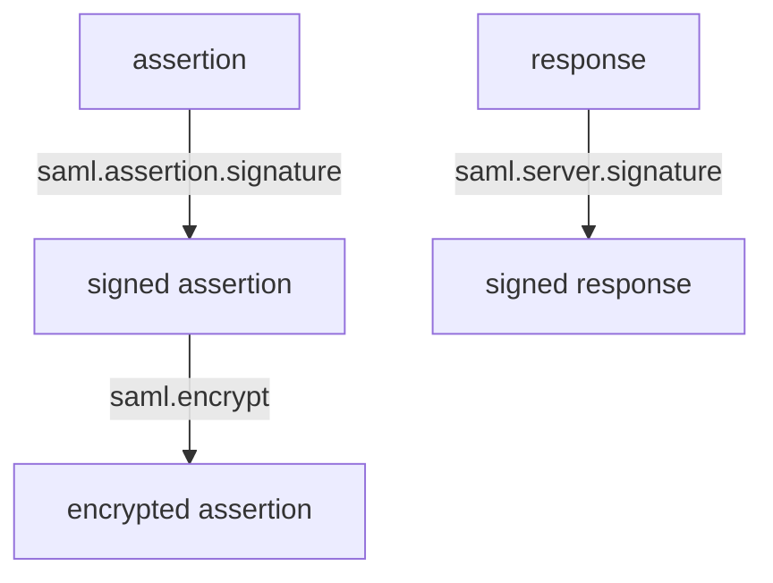

# Signatures And Encryption

An assertion is only worth anything if the SP can tell that Keycloak wrote it and nobody changed it. SAML protects this with XML signatures. Keycloak lets you sign the whole response, the assertion inside it, or both, and lets you require that the SP signs its requests.

## What can be signed

| Setting (client attribute) | Effect |
| --- | --- |
| `saml.server.signature` | Keycloak signs the whole `Response` document |
| `saml.assertion.signature` | Keycloak signs the `Assertion` element |
| `saml.client.signature` | Keycloak requires the SP to sign its requests and checks them |
| `saml.encrypt` | Keycloak encrypts the assertion with the SP's public key |

The SP needs at least one of the first two to be on, because an unsigned assertion can be forged by anyone who can reach the ACS address. Many SPs require the assertion signature specifically, others the response signature. Sign the assertion, and also the response if the SP accepts it, unless the SP documentation says otherwise.

The attribute `saml.signature.algorithm` picks the algorithm, with `RSA_SHA256` as the usual value. `RSA_SHA1` is weak and only for old SPs that cannot do better.

## Set and read the signing settings

<!-- astrona:playground:renew -->

```sh
NAMESPACE=saml-demo
kcadm() {
  kubectl -n "$NAMESPACE" exec -i deploy/keycloak -- \
    /opt/keycloak/bin/kcadm.sh "$@" --config /tmp/kcadm.config
}
kcadm config credentials --server http://localhost:8080 --realm master --user admin --password admin
CLIENT_ID=$(kcadm get clients -r inventory -q clientId=urn:app:billing --fields id --format csv --noquotes | tr -d '\r')
kcadm update "clients/$CLIENT_ID" -r inventory \
  -s 'attributes."saml.assertion.signature"=true' \
  -s 'attributes."saml.server.signature"=true' \
  -s 'attributes."saml.signature.algorithm"=RSA_SHA256'
kcadm get "clients/$CLIENT_ID" -r inventory --fields attributes
```

The keys come from the realm, not the client. Keycloak signs with the realm's active RSA key and publishes its certificate in the descriptor.

## Require signed requests

With `saml.client.signature` on, Keycloak checks the signature of every `AuthnRequest` against the certificate stored in the client. This stops a third party from starting sign-ins in the name of the SP. It needs the SP's certificate in the client's attribute `saml.signing.certificate`. Turn the setting on only after the certificate is stored, or every sign-in of that SP fails.

## Encryption

With `saml.encrypt` on, Keycloak encrypts the assertion with the SP's public key from `saml.encryption.certificate`. Only the SP can read the assertion, which matters when it passes through a browser that could expose it to scripts or logs. Encryption does not replace the signature; the signature still proves the origin.



The diagram shows that each switch protects a different layer, and they combine.

You now know which documents are signed and why. The last part covers what the assertion says about the user and how logout works.

## Common pitfalls

> [!WARNING]
> - **Turning off both signature switches.** The SP cannot trust the assertion.
> - **Requiring client signatures without storing the SP certificate.** Every request fails validation.
> - **Using `RSA_SHA1` for a new SP.** Choose `RSA_SHA256`.
> - **Forgetting to give the SP the new descriptor after a key rotation.**
