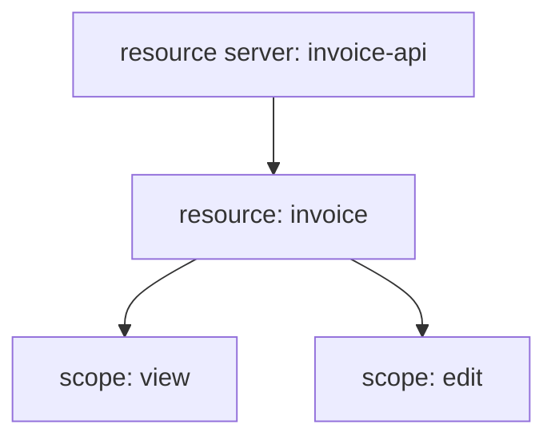

# Resource Servers, Resources And Scopes

Authorization Services is a feature of a **client**. When you turn it on for a client, that client becomes a **resource server**: the place where protected resources are described and where permission decisions are made.

## Enable it

A resource server must be a confidential client with a service account. In the admin API these are the client attributes `serviceAccountsEnabled` and `authorizationServicesEnabled`:

<!-- astrona:playground:renew -->

```sh
NAMESPACE=authz-demo
kcadm() {
  kubectl -n "$NAMESPACE" exec -i deploy/keycloak -- \
    /opt/keycloak/bin/kcadm.sh "$@" --config /tmp/kcadm.config
}
kcadm config credentials --server http://localhost:8080 --realm master --user admin --password admin
RS_ID=$(kcadm get clients -r inventory -q clientId=invoice-api --fields id --format csv --noquotes | tr -d '\r')
kcadm get "clients/$RS_ID/authz/resource-server" -r inventory --fields policyEnforcementMode,decisionStrategy
```

The answer shows `policyEnforcementMode` as `ENFORCING`. With the feature on, the client gets a tab for authorization with resources, scopes, policies and permissions. A new resource server starts with one default resource, one default policy and one default permission.

## Resources

A **resource** is something you protect: an invoice, a report, a whole API. It has a name, an optional type, optional URIs and a list of scopes. Create one:

```sh
kcadm create "clients/$RS_ID/authz/resource-server/resource" -r inventory \
  -b '{"name":"invoice","type":"urn:invoice-api:resources:invoice","scopes":[{"name":"view"},{"name":"edit"}]}'
kcadm get "clients/$RS_ID/authz/resource-server/resource" -r inventory -q name=invoice --fields _id,name,scopes
```

The resource ID field is named `_id`. Creating the resource with scope names also creates the scopes, if they do not exist yet.

## Scopes

A **scope** is an action on a resource, such as `view`, `edit` or `delete`. Do not confuse it with an OAuth client scope; here it is a permission verb. Scopes belong to the resource server, and several resources can use the same scope:

```sh
kcadm get "clients/$RS_ID/authz/resource-server/scope" -r inventory --fields id,name
```

Keep resources few and scopes meaningful. A resource per row in a database makes the model hard to manage; a resource per kind of object, or per API, with scopes for the actions, is easier.



The diagram shows a resource server that holds a resource with two scopes.

You can now describe what is protected. Nothing is allowed yet: a request for `invoice#view` is denied until a permission covers it. The next part adds policies and permissions.

## Common pitfalls

> [!WARNING]
> - **Enabling Authorization Services on a public client.** The client must be confidential and have a service account.
> - **Mixing up authorization scopes and client scopes.** They are different objects.
> - **Reading `id` where the resource uses `_id`.** The resource ID field has an underscore.
> - **One resource per object instance.** Prefer a resource per kind of object.
