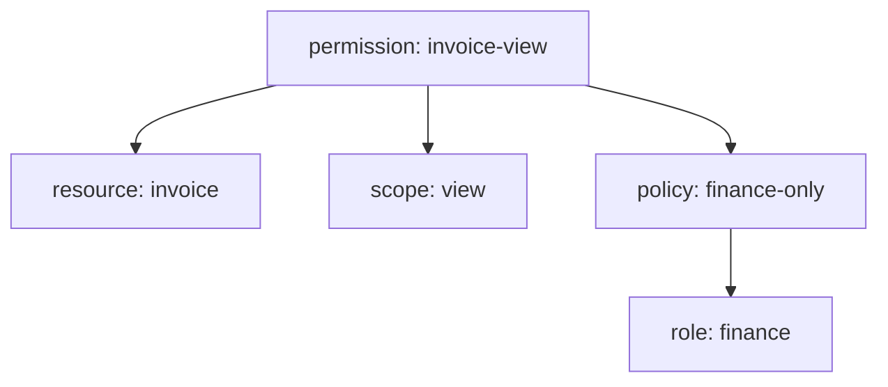

# Policies And Permissions

A policy says who passes. A permission says what the policy protects. Splitting the two lets you reuse one policy, for example "finance users", in many permissions.

## Policies

A **policy** is a rule with a type. It is evaluated for the user who asks and gives a decision. The common types:

| Type | Passes when |
| --- | --- |
| Role | The user has one of the listed roles (each can be marked required) |
| User | The user is in the list |
| Group | The user is a member of a listed group |
| Client | The request comes from a listed client |
| Time | The current time is inside a window |
| Aggregated | The listed policies pass, by their own strategy |
| JavaScript | A script returns a grant; the feature is disabled by default |

Every policy has a **logic**: `POSITIVE` keeps its result, `NEGATIVE` inverts it. A negative role policy passes users who do not have the role.

Create a role policy for the finance role. The body needs the role's ID:

<!-- astrona:playground:renew -->

```sh
NAMESPACE=authz-demo
kcadm() {
  kubectl -n "$NAMESPACE" exec -i deploy/keycloak -- \
    /opt/keycloak/bin/kcadm.sh "$@" --config /tmp/kcadm.config
}
kcadm config credentials --server http://localhost:8080 --realm master --user admin --password admin
RS_ID=$(kcadm get clients -r inventory -q clientId=invoice-api --fields id --format csv --noquotes | tr -d '\r')
ROLE_ID=$(kcadm get roles/finance -r inventory --fields id --format csv --noquotes | tr -d '\r')
kcadm create "clients/$RS_ID/authz/resource-server/policy/role" -r inventory \
  -b "{\"name\":\"finance-only\",\"type\":\"role\",\"logic\":\"POSITIVE\",\"decisionStrategy\":\"UNANIMOUS\",\"roles\":[{\"id\":\"$ROLE_ID\",\"required\":false}]}"
kcadm get "clients/$RS_ID/authz/resource-server/policy" -r inventory -q name=finance-only --fields id,name,type,logic
```

## Permissions

A **permission** attaches policies to a resource or to scopes. A **resource-based permission** protects a resource as a whole, for every scope. A **scope-based permission** protects one or more scopes, for one resource or for all resources. Create a scope-based permission that lets finance users view invoices:

```sh
RES_ID=$(kcadm get "clients/$RS_ID/authz/resource-server/resource" -r inventory -q name=invoice --fields _id --format csv --noquotes | tr -d '\r')
SCOPE_ID=$(kcadm get "clients/$RS_ID/authz/resource-server/scope" -r inventory -q name=view --fields id --format csv --noquotes | tr -d '\r')
POLICY_ID=$(kcadm get "clients/$RS_ID/authz/resource-server/policy" -r inventory -q name=finance-only --fields id --format csv --noquotes | tr -d '\r')
kcadm create "clients/$RS_ID/authz/resource-server/permission/scope" -r inventory \
  -b "{\"name\":\"invoice-view\",\"type\":\"scope\",\"logic\":\"POSITIVE\",\"decisionStrategy\":\"UNANIMOUS\",\"resources\":[\"$RES_ID\"],\"scopes\":[\"$SCOPE_ID\"],\"policies\":[\"$POLICY_ID\"]}"
```

Only users with the finance role can now view an invoice. Nobody can edit one, because no permission covers `edit`. This default-deny rule is the main safety property: **what no permission covers, nobody may do.**



The diagram shows a permission that joins a resource, a scope and a policy, and a policy that checks a role.

You now know how the model decides. Asking Keycloak for a decision is the next part.

## Common pitfalls

> [!WARNING]
> - **A permission without a policy.** It has nothing to evaluate and does not grant access.
> - **Forgetting the logic of a policy.** A negative policy turns "has the role" into "does not have the role".
> - **Reusing the default permission by accident.** The default permission covers resources of the default type.
> - **Using the role name where the API wants the role ID.**
