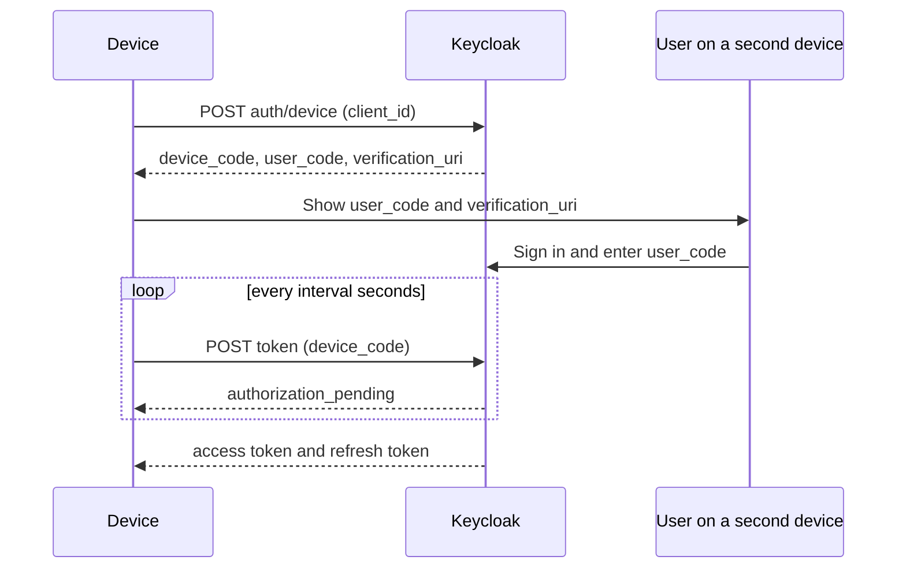

# How The Device Flow Works

The device flow has two actors on two devices. The **device** has the application but a poor input method. The **second device** has a browser. Keycloak talks to both.

## The steps

1. The device sends its client ID to the **device authorization endpoint**.
2. Keycloak answers with a **device code**, a **user code**, a **verification address**, a lifetime and a polling interval.
3. The device shows the user code and the verification address to the user, often as text and a QR code.
4. The user opens the verification address on a second device and signs in as usual, with every login method the realm offers. The user types the user code and approves the request.
5. Meanwhile the device **polls** the token endpoint with the device code.
6. Until the user approves, the token endpoint answers `authorization_pending`. After approval, the device receives its tokens.



## The endpoints

Both endpoints are in the realm's OpenID Connect discovery document as `device_authorization_endpoint` and `token_endpoint`:

```text
/realms/<realm>/protocol/openid-connect/auth/device
/realms/<realm>/protocol/openid-connect/token
```

The device request has no secret for a public client. It is a plain form post:

<!-- astrona:playground:renew -->

```sh
NAMESPACE=device-demo
kubectl -n "$NAMESPACE" exec deploy/tester -- \
  curl -s http://keycloak:8080/realms/inventory/protocol/openid-connect/auth/device \
    -d client_id=kiosk | jq .
```

If the client has the grant enabled, the answer holds these fields:

| Field | Meaning |
| --- | --- |
| `device_code` | A long secret that only the device keeps and sends when polling |
| `user_code` | A short code that the user types, built to be easy to read and type |
| `verification_uri` | The address where the user enters the code |
| `verification_uri_complete` | The same address with the code included, for a QR code |
| `expires_in` | Seconds until the codes stop working |
| `interval` | The minimum seconds between two polls |

## Why two codes

The **device code** is private and long, so nobody can guess it. The **user code** is short because a person must type it, so it is useful only for a limited time and it is useless without a signed-in user who approves it. They are linked inside Keycloak. Never show the device code on the screen.

## Common pitfalls

> [!WARNING]
> - **Showing the device code to the user.** Only the user code and the address are shown.
> - **Looking for a redirect URI.** The flow has none; the client does not need one.
> - **Expecting a browser on the device.** The sign-in happens on the second device.
> - **Using the flow for a normal web application.** The authorization code flow with PKCE is the right choice when a browser is there.
