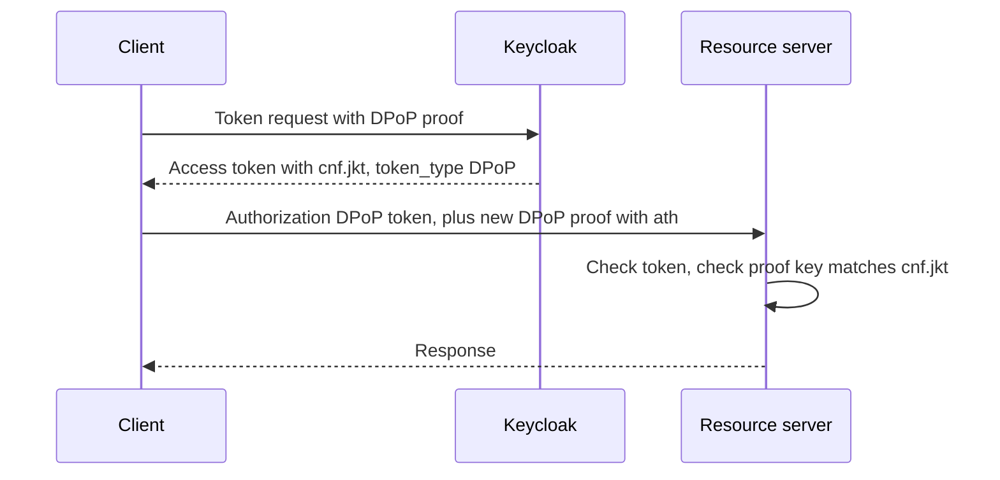

# DPoP In Keycloak

**DPoP** means Demonstrating Proof of Possession. The client creates a key pair and sends a small signed JWT, the **proof**, with each request. Keycloak supports DPoP as a supported feature, with a client setting to require it.

## The proof

The proof is a JWT sent in the `DPoP` request header. Its header carries the type, the algorithm and the **public key**:

```json
{ "typ": "dpop+jwt", "alg": "ES256", "jwk": { "kty": "EC", "crv": "P-256", "x": "...", "y": "..." } }
```

Its payload says which request it belongs to:

```json
{ "jti": "unique id", "htm": "POST", "htu": "https://auth.example.com/realms/inventory/protocol/openid-connect/token", "iat": 1700000000 }
```

| Claim | Meaning |
| --- | --- |
| `jti` | A unique id, so a proof cannot be replayed |
| `htm` | The HTTP method of the request |
| `htu` | The URL of the request, without query and fragment |
| `iat` | When the proof was created; the server accepts only a short window |
| `ath` | For resource requests: a hash of the access token, binding proof to token |
| `nonce` | When the server asks for one, a value it supplied |

The proof is signed with the private key that matches the `jwk` in its header. A new proof is made for every request.

## The flow



The token response has `token_type` equal to `DPoP`. The client then sends `Authorization: DPoP <token>` and a fresh `DPoP` header to the resource server.

## The client setting

In the admin console the setting is "Require DPoP bound tokens" under the advanced settings of a client. In the API it is the attribute `dpop.bound.access.tokens`. With it on, Keycloak rejects a token request that has no valid proof.

<!-- astrona:playground:renew -->

```sh
NAMESPACE=bound-demo
kcadm() {
  kubectl -n "$NAMESPACE" exec -i deploy/keycloak -- \
    /opt/keycloak/bin/kcadm.sh "$@" --config /tmp/kcadm.config
}
kcadm config credentials --server http://localhost:8080 --realm master --user admin --password admin
kcadm get clients -r inventory -q clientId=payments-client --fields clientId,attributes
```

Request a token without a proof for each client and compare the status codes:

```sh
for C in payments legacy; do
  kubectl -n "$NAMESPACE" exec deploy/tester -- \
    curl -s -o /dev/null -w "$C %{http_code}\n" http://keycloak:8080/realms/inventory/protocol/openid-connect/token \
      -d grant_type=client_credentials -d client_id=$C-client -d client_secret=$C-secret
done
```

The client that requires DPoP is refused, and the other gets a token. The discovery document lists the accepted proof algorithms in `dpop_signing_alg_values_supported`.

## Change the setting

```sh
CLIENT_ID=$(kcadm get clients -r inventory -q clientId=legacy-client --fields id --format csv --noquotes | tr -d '\r')
kcadm update "clients/$CLIENT_ID" -r inventory -s 'attributes."dpop.bound.access.tokens"=true'
```

Turn it back to `false` when you are done exploring.

## Refresh tokens

For a public client, DPoP also binds the refresh token, so a stolen refresh token cannot be used without the key. For a confidential client the refresh token is protected by client authentication.

## Your mission: Require DPoP Binding Lab

The mission starts from a payments client that still issues plain bearer tokens. You require binding on it without breaking the client that cannot send proofs.

The lab runs in its own cluster, so first pause your playground. Nothing in it is lost:

```sh
astrona stop ats-090-playground-130-01
```

Then start the lab:

```sh
astrona run --git ssh://git@github.com/astrona-io/ATS090.git -c sections/section-130/module-01/labs/lab-01
```

The task is on the next page. Solve it on your own first. When you think you are done, send it for grading:

```sh
astrona submit -c sections/section-130/module-01/labs/lab-01
```

When the lab is done, remove it and start your playground again:

```sh
astrona destroy ats-090-lab-130-01
astrona start ats-090-playground-130-01
```

## Common pitfalls

> [!WARNING]
> - **Reusing one proof.** A proof is for one method and one URL; make a new one each time.
> - **Using the wrong URL in `htu`.** Behind a proxy, use the public URL that the server sees.
> - **Sending `Authorization: Bearer` with a DPoP token.** Use the `DPoP` scheme.
> - **Requiring DPoP on a client whose software cannot sign proofs.** It will stop working at once.
